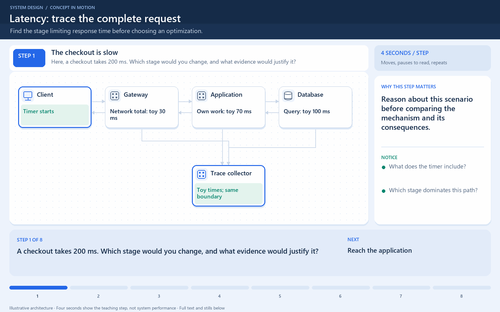

# Latency vs Throughput vs Bandwidth

[← Category](README.md) · [Schedule](../../SCHEDULE.md)

<!-- BEGIN INQUIRY -->
## Try solving this first

A sale dashboard celebrates 10,000 completed checkouts per minute, while social media fills with screenshots of ten-second waits. A trace shows a fast network, a growing database queue, and a few very slow requests. Which number describes the customer’s pain? Would more bandwidth, more workers, or a faster query help—and how would you prove it?
<!-- END INQUIRY -->

## The three questions

| Measure | Question it answers | Common units | Example |
| --- | --- | --- | --- |
| Latency | How long does one operation take? | milliseconds or seconds | An order response takes 200 ms. |
| Throughput | How much work finishes per unit time? | requests/second, orders/minute, bytes/second | A service completes 500 requests/second. |
| Bandwidth | How much data can this connection carry per unit time? | bits/second | A link has a nominal capacity of 100 megabits/second. |

Always say which operation, which boundary, and which unit you measured. A user's complete page load can include DNS, connection setup, server work, file downloads, and browser rendering. A database's reported query time covers a much smaller boundary.

## Start with a familiar situation

At a checkout, latency is the time one customer spends waiting and being served. Throughput is how many customers finish in an hour. Adding another cashier may let more customers finish without making either cashier scan an individual basket faster.

For bandwidth, imagine a delivery road's carrying capacity. A wider road can carry more goods together; it does not necessarily make one vehicle complete a long journey sooner. Similarly, a distant server can have a high-capacity connection and still require a noticeable round trip. These analogies help separate the questions; computers also have queues, shared resources, and protocol overhead.

## Where this comes into play

- **Interactive checkout or search:** users notice response time, especially unusually slow requests.
- **A sale or ticket release:** you need enough completed requests per second while keeping delays and failures acceptable.
- **Video or file delivery:** the amount of data transferred can make available bandwidth a bottleneck.
- **Background processing:** total jobs completed per hour may matter more than one job's response time, unless jobs have deadlines.

The same system can have all these goals. Name the goal before saying that a change “makes it faster.”

## Work through a slow request

Assume one request performs these steps sequentially. The numbers are illustrative, not benchmark results.

For this simplified path, `30 + 70 + 100 = 200 ms`. Suppose a suitable database index reduces the query from 100 ms to 25 ms. The new total is `30 + 70 + 25 = 125 ms`: 75 ms saved, or 37.5% lower latency for this example. The index can cost storage and extra write work.

Doubling the network link's capacity may barely change that request if its payload is tiny and most time is spent in the query. Adding application servers may help when application CPU or waiting capacity is saturated, but it will not remove a shared database bottleneck.

For parallel work, do not simply add every span's duration. Two independent calls running together contribute approximately their longest duration to that part of the critical path, plus coordination overhead. Dependent calls cannot automatically be parallelized.

## How to optimize the right thing

| What measurements show | Change to investigate | Why it can help | Cost or limit |
| --- | --- | --- | --- |
| Slow queries dominate request time. | Query shape, indexes, fewer database round trips. | Reduces work on the critical path. | Index maintenance and changed access patterns matter. |
| Repeated reads return the same data. | Cache suitable results. | Avoids repeated expensive work. | Freshness, invalidation, memory, and misses. |
| Several independent remote calls happen sequentially. | Batch requests or run independent calls concurrently. | Reduces repeated waiting. | Larger batches or excess concurrency can overload dependencies. |
| CPU and the request queue grow under load. | Reduce CPU work, bound concurrency, or add capacity. | Addresses the saturated stage. | More instances cost money and may shift the bottleneck. |
| Large responses fill the network link. | Smaller payloads, suitable compression, or nearby content delivery. | Moves fewer bytes or reduces long-distance delivery. | Compression costs CPU; already compressed data may gain little. |
| A downstream service is overloaded. | Admission limits, backpressure, and realistic timeouts. | Prevents unbounded waiting and cascading failure. | Some work is delayed or rejected rather than magically completed. |

Begin with a trace or timing breakdown, form one hypothesis, and compare before and after at a similar workload. Track failures too: rejecting most requests can make the remaining successful requests look deceptively fast.

## Throughput, concurrency, and waiting

Concurrency is how many operations are in progress. It is not the same as completed operations per second.

Under a stable workload, a useful average relationship is:

`average operations in progress = completed operations/second × average time in the system`

This is Little's Law. If a stable service completes 500 requests/second and requests spend 0.2 seconds inside the measured boundary on average, roughly 100 requests are in progress there on average. Include waiting inside that boundary; do not mix a server-only duration with a whole-system request count.

Increasing the in-progress limit does not guarantee more completions. Beyond the bottleneck's capacity, it can mainly create a longer queue. The relationship describes stable averages, not a promise that adding threads produces a particular throughput.

## Why the average is not enough

Suppose 100 requests contain ninety requests taking 100 ms and ten taking 1,100 ms. The average is 200 ms, but one in ten users waits over a second.

**p50**, the median, describes a typical middle request. **p95** is a duration at or below which about 95% of requests finish. Here p95 is 1,100 ms under the usual nearest-rank calculation. High percentiles reveal slow requests that an average can hide. Measure comparable operations separately so fast error responses do not mask slow successful checkout requests.

## A bandwidth calculation

At 100 megabits/second, dividing by eight gives a theoretical 12.5 megabytes/second, using decimal units. A 10 MB file therefore needs at least about `10 / 12.5 = 0.8 seconds` of transfer time under ideal assumptions. Real completion also includes protocol overhead, connection behavior, sharing, and other delays. Bits and bytes differ by a factor of eight; state which one you use.

## Check your understanding

1. Two servers finish twice as many requests per second, but each request still takes 200 ms. **Throughput improved; individual latency did not.**
2. A page is slow because it makes five small, dependent calls to a distant region. Is more bandwidth the first fix? **Not necessarily: round-trip delay and call dependency may dominate.**
3. An index lowers average latency but write errors rise sharply. Is the change successful? **Not yet: assess correctness, write cost, errors, and latency together.**

<!-- BEGIN ANIMATION -->
## Watch the sequence

[Read the numbered steps](../../animations/request-latency.md) · [View the still sequence](../../assets/animations/request-latency-steps.png)
<!-- END ANIMATION -->

## Optional further reading

- [Additional explanation](https://algomaster.io/learn/system-design/latency-vs-throughput)
- [Google SRE: measuring latency, traffic, errors, and saturation](https://sre.google/sre-book/monitoring-distributed-systems/)

The worked scenarios and numbers here are illustrative; measure your own workload before choosing an optimization.
