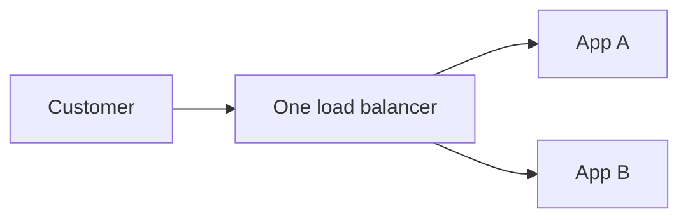

# SPOF

[← Category](README.md) · [Schedule](../../SCHEDULE.md)

## One failure that stops the whole path

A **single point of failure** is a component whose failure can stop the service you care about.

There are two application servers, but both depend on the same load balancer. If it fails and no replacement takes over, neither app is reachable through this path.

Redundancy helps only if the replacement actually works. Two servers sharing one power supply still share a failure risk. Two database replicas can both receive the same accidental deletion.

Start at the user and trace each dependency. For each, ask: “If this stops, what still works, and who switches to the replacement?” Consider a degraded mode too: customers might browse cached products while checkout is unavailable.

**Check:** adding a second app server does not remove a single shared database as a possible failure point.

## Optional further reading

- [Additional explanation](https://algomaster.io/learn/system-design/single-point-of-failure-spof)

The lesson above is complete enough for this curriculum; external links are for deeper study.
