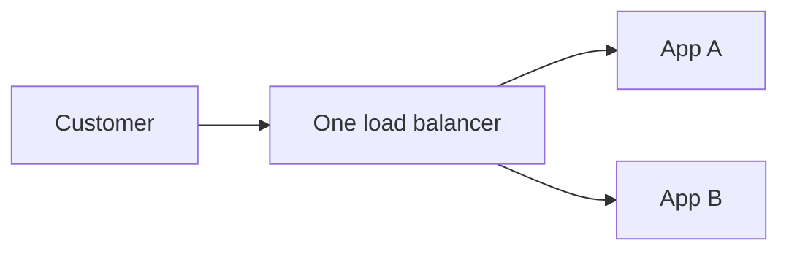

# SPOF

[← Category](README.md) · [Schedule](../../SCHEDULE.md)

<!-- BEGIN INQUIRY -->
## Try solving this first

Your architecture diagram proudly shows six application replicas. During a launch, one tiny configuration service stops responding and every replica refuses new traffic. The servers are alive, but the product is gone. Which dependency actually controlled availability? Where would another copy help, and who decides which copy is safe to trust?
<!-- END INQUIRY -->

## One failure that stops the whole path

A **single point of failure** is a component whose failure can stop the service you care about.

There are two application servers, but both depend on the same load balancer. If it fails and no replacement takes over, neither app is reachable through this path.

Redundancy helps only if the replacement actually works. Two servers sharing one power supply still share a failure risk. Two database replicas can both receive the same accidental deletion.

Start at the user and trace each dependency. For each, ask: “If this stops, what still works, and who switches to the replacement?” Consider a degraded mode too: customers might browse cached products while checkout is unavailable.

**Check:** adding a second app server does not remove a single shared database as a possible failure point.

## Where this comes into play

Review a service's request path before promising availability: load balancer, application instances, database, identity service, configuration, and network access. Also inspect shared dependencies such as one region or one credential needed by every instance.

## Worked example: two applications, one database

Two app servers both use database D. Losing an app server can be handled by routing to the other. Losing D stops checkout unless another suitable database instance can take over. A failover plan needs data replication, a promotion decision, a stable address or discovery change, and client reconnection. A diagram with a standby box does not establish that these steps work.

## How to improve it

Identify the failure that matters, then remove that dependency or provide a tested replacement. Place replacements in genuinely different failure domains where appropriate. Designate who may accept writes after promotion; an isolated old primary must not continue accepting conflicting writes without a coordination rule.

For noncritical dependencies, a fallback can be cheaper than duplicating everything. If product recommendations fail, show the product page without recommendations. That helps browsing but is not an acceptable substitute for a required payment confirmation.

Redundancy also introduces cost and coordination. Automatic failover can produce false promotions if health checks confuse a network delay with a dead server.

## How to verify improvement

Fail one dependency at a time and trace a real request. Measure detection time, switchover time, rejected work, and any data loss. Include common-cause failures: both replicas sharing the same broken configuration can fail together.

## Optional further reading

- [Additional explanation](https://algomaster.io/learn/system-design/single-point-of-failure-spof)

Optional references provide more detail; they are not required to follow this lesson.
