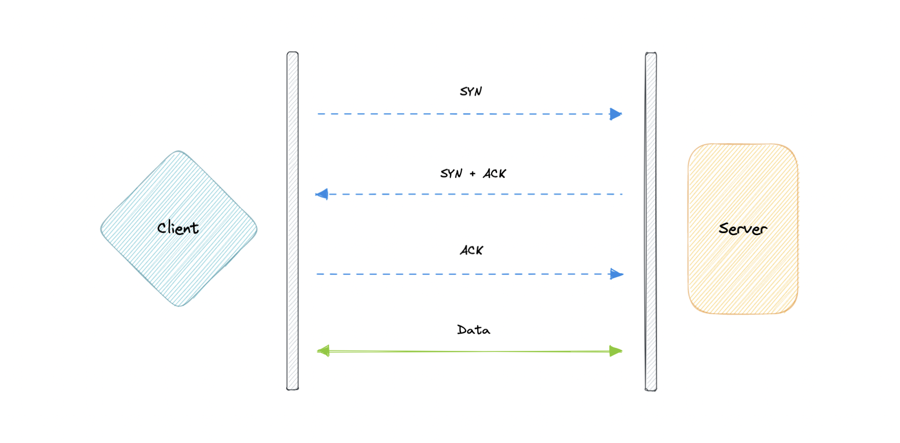
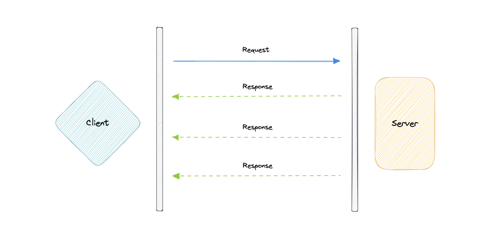
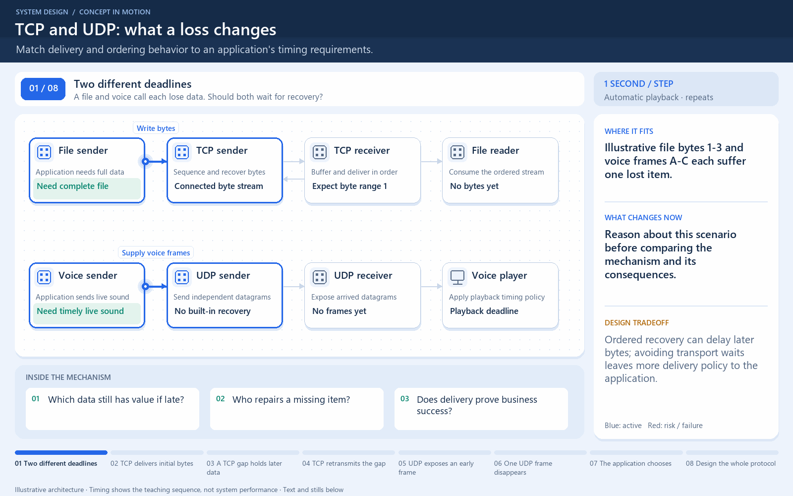

[← Category](README.md) · [Schedule](../../SCHEDULE.md)

> **Reading note:** some statements in the preserved passage need clarification. Read [Make it concrete](#make-it-concrete) with it.

<!-- BEGIN INQUIRY -->
## Try solving this first

During a live match, one missing audio packet arrives two seconds late and interrupts the current commentary. In the same app, a missing payment byte would corrupt a charge request. Which data should wait for recovery, which should move on, and what must the application still handle even when the transport promises ordered delivery?
<!-- END INQUIRY -->

<!-- BEGIN ORIGINAL TOPIC -->
# TCP and UDP

## TCP

Transmission Control Protocol (TCP) is connection-oriented, meaning once a connection has been established, data can be transmitted in both directions. TCP has built-in systems to check for errors and to guarantee data will be delivered in the order it was sent, making it the perfect protocol for transferring information like still images, data files, and web pages.

But while TCP is instinctively reliable, its feedback mechanisms also result in a larger overhead, translating to greater use of the available bandwidth on the network.

## UDP

User Datagram Protocol (UDP) is a simpler, connectionless internet protocol in which error-checking and recovery services are not required. With UDP, there is no overhead for opening a connection, maintaining a connection, or terminating a connection. Data is continuously sent to the recipient, whether or not they receive it.

It is largely preferred for real-time communications like broadcast or multicast network transmission. We should use UDP over TCP when we need the lowest latency and late data is worse than the loss of data.

## TCP vs UDP

TCP is a connection-oriented protocol, whereas UDP is a connectionless protocol. A key difference between TCP and UDP is speed, as TCP is comparatively slower than UDP. Overall, UDP is a much faster, simpler, and more efficient protocol, however, retransmission of lost data packets is only possible with TCP.

TCP provides ordered delivery of data from user to server (and vice versa), whereas UDP is not dedicated to end-to-end communications, nor does it check the readiness of the receiver.

| Feature             | TCP                                         | UDP                                |
| ------------------- | ------------------------------------------- | ---------------------------------- |
| Connection          | Requires an established connection          | Connectionless protocol            |
| Guaranteed delivery | Can guarantee delivery of data              | Cannot guarantee delivery of data  |
| Re-transmission     | Re-transmission of lost packets is possible | No re-transmission of lost packets |
| Speed               | Slower than UDP                             | Faster than TCP                    |
| Broadcasting        | Does not support broadcasting               | Supports broadcasting              |
| Use cases           | HTTPS, HTTP, SMTP, POP, FTP, etc            | Video streaming, DNS, VoIP, etc    |
<!-- END ORIGINAL TOPIC -->

<!-- BEGIN ANIMATION -->
## Watch the sequence

[Read the numbered steps](../../animations/tcp-udp.md) · [View the still sequence](../../assets/animations/tcp-udp-steps.png)
<!-- END ANIMATION -->

## Make it concrete

TCP supplies an ordered byte stream with loss recovery; a missing range can delay later bytes. UDP exposes datagrams without built-in delivery or ordering guarantees; applications can add recovery.

Choose using measured loss, delay, and required ordering. Reuse connections where appropriate. For UDP, design congestion handling, message sizing, and loss policy explicitly; it is not automatically faster.

TCP can fail, and successful transport delivery does not prove a payment committed.

### Match the promise to the data

For downloading a document, missing bytes make the result unusable, so reliable ordered delivery is helpful. For a live voice stream, a late audio sample may be less useful than playing the next sample on time. The application still needs to decide how it handles gaps; selecting UDP does not magically solve congestion or guarantee low latency.

In a payment service, TCP can deliver bytes and then the connection can disappear before the response reaches the caller. The caller still cannot infer whether the business operation succeeded. That uncertainty needs application-level operation identifiers and recovery, even though transport is reliable.

Draw both layers separately: delivery of data, and confirmation of the requested business effect. **Question:** after a timeout, what evidence could distinguish “nothing happened” from “the operation succeeded but its response was lost”?

[Next topic in this category](README.md) · [Credits and license](../../ATTRIBUTION.md)
