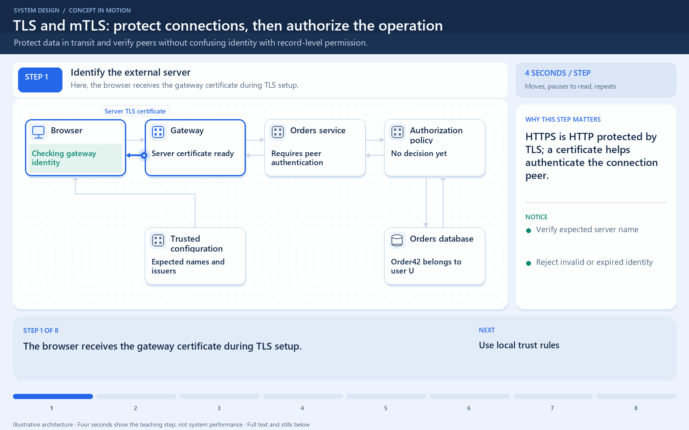

# HTTP/HTTPS

[← Category](README.md) · [Schedule](../../SCHEDULE.md)

<!-- BEGIN INQUIRY -->
## Try solving this first

A mobile app's first product request is slow, while later requests are faster. The order endpoint uses HTTPS, yet one customer can still request someone else's order by changing an identifier. Then a checkout request times out after the server may have created the order. Which parts of these problems concern connection setup, protected transport, authorization, and business-level retry behavior?
<!-- END INQUIRY -->

## A request and its response

HTTP defines how a client asks for a resource or operation and how a server responds. A request includes a method, path, headers, and sometimes a body. The response includes a status, headers, and sometimes a body.

Example: `GET /products/42` asks for a product. `POST /orders` can submit an order. A successful order response might return `201 Created` and the new order's identifier.

**HTTPS is HTTP protected by TLS**, or Transport Layer Security, the protocol protecting the connection. TLS encrypts data in transit and normally lets the client verify the server's identity. It does not decide whether the signed-in user owns a particular order; the application must still check authorization.

An HTTP response and a business result are different layers. A network timeout does not prove an order was never created: the response might have been lost after the server committed it. Retrying a write therefore needs deliberate duplicate handling.

**Check:** HTTPS protects a password while it travels over the connection. It does not automatically protect a poorly secured database where the application stores it.

## Where this comes into play

These concepts affect browser APIs, mobile backends, service calls, proxies, and content delivery. Diagnose the request lifecycle rather than assuming that a slow page means slow application code.

## Follow a request

A first visit can require name resolution, connection establishment, TLS negotiation, the request/response, and downloading the body. A later request may reuse an existing connection. A redirect adds another exchange. These stages explain why server processing time and user-observed time can differ substantially.

## How to optimize responsibly

- Reuse connections where supported instead of paying setup costs for every call. Manage idle connections and pool limits so reuse does not exhaust resources.
- Reduce unnecessary redirects and repeated small requests. A bigger batch can reduce round trips but may increase payload size and delay partial results.
- Cache responses that can safely be reused, with deliberate freshness and access rules. A personalized response must not accidentally become a shared public cache entry.
- Compress suitable text responses. Measure CPU cost and do not expect large gains from already compressed images or video.
- Move static public content closer to users when distance or origin traffic is the bottleneck.

Keep TLS and authorization checks. Removing security is not an acceptable performance shortcut. Likewise, retrying every write after a timeout can repeat a business operation even when the transport request failed to return a response.

## How to verify improvement

Separate connection/setup time, time until the first response byte, and body transfer time. Compare response sizes, error rates, and latency percentiles under equivalent load. Check both new-connection and reused-connection requests.

<!-- BEGIN ANIMATION -->
## Watch the sequence

[Read the numbered steps](../../animations/tls-mtls.md) · [View the still sequence](../../assets/animations/tls-mtls-steps.png)
<!-- END ANIMATION -->

## Optional further reading

- [Additional explanation](https://algomaster.io/learn/system-design/http-https)

Optional references provide more detail; they are not required to follow this lesson.
