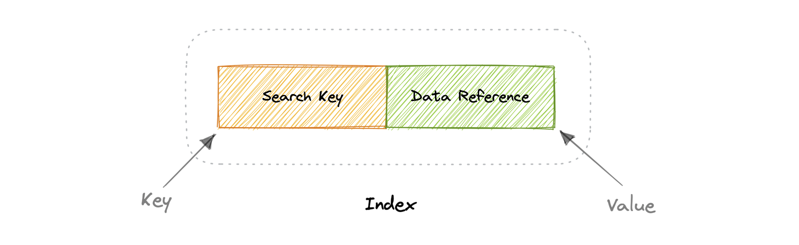
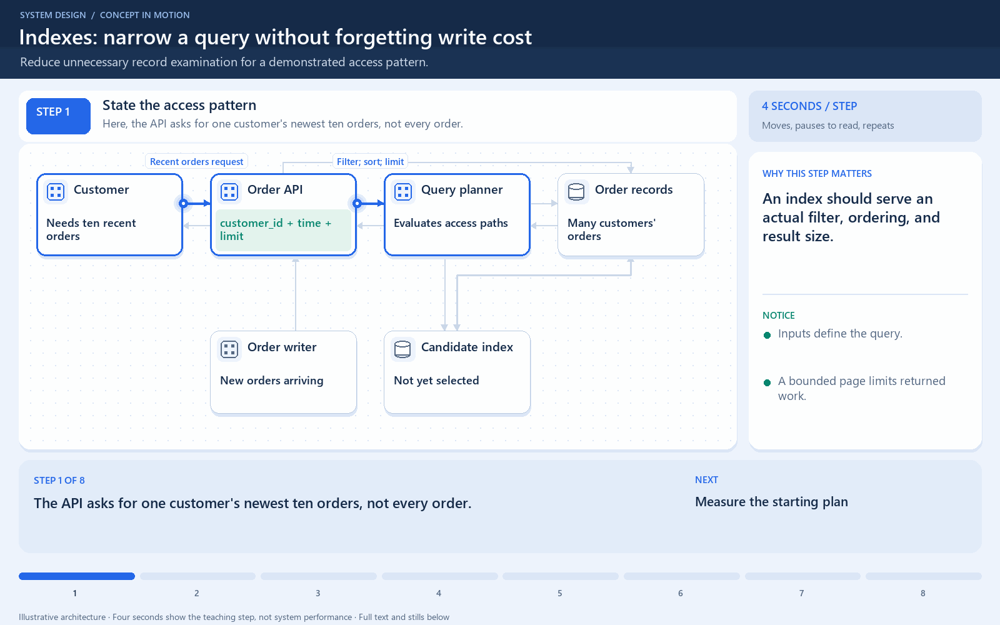

[← Category](README.md) · [Schedule](../../SCHEDULE.md)

<!-- BEGIN INQUIRY -->
## Try solving this first

A customer opens “My last 20 orders.” The database examines 80 million rows, sorts the matches, and returns twenty records after six seconds. Someone proposes indexing every column. Which path would let the database find the needed range directly, what write cost would it add, and what evidence in the query plan would prove it worked?
<!-- END INQUIRY -->

<!-- BEGIN ORIGINAL TOPIC -->
# Indexes

Indexes are well known when it comes to databases, they are used to improve the speed of data retrieval operations on the data store. An index makes the trade-offs of increased storage overhead, and slower writes (since we not only have to write the data but also have to update the index) for the benefit of faster reads. Indexes are used to quickly locate data without having to examine every row in a database table. Indexes can be created using one or more columns of a database table, providing the basis for both rapid random lookups and efficient access to ordered records.

An index is a data structure that can be perceived as a table of contents that points us to the location where actual data lives. So when we create an index on a column of a table, we store that column and a pointer to the whole row in the index. Indexes are also used to create different views of the same data. For large data sets, this is an excellent way to specify different filters or sorting schemes without resorting to creating multiple additional copies of the data.

One quality that database indexes can have is that they can be **dense** or **sparse**. Each of these index qualities comes with its own trade-offs. Let's look at how each index type would work:

## Dense Index

In a dense index, an index record is created for every row of the table. Records can be located directly as each record of the index holds the search key value and the pointer to the actual record.

Dense indexes require more maintenance than sparse indexes at write-time. Since every row must have an entry, the database must maintain the index on inserts, updates, and deletes. Having an entry for every row also means that dense indexes will require more memory. The benefit of a dense index is that values can be quickly found with just a binary search. Dense indexes also do not impose any ordering requirements on the data.

## Sparse Index

In a sparse index, index records are created only for some of the records.

Sparse indexes require less maintenance than dense indexes at write-time since they only contain a subset of the values. This lighter maintenance burden means that inserts, updates, and deletes will be faster. Having fewer entries also means that the index will use less memory. Finding data is slower since a scan across the page typically follows the binary search. Sparse indexes are also optional when working with ordered data.
<!-- END ORIGINAL TOPIC -->

<!-- BEGIN ANIMATION -->
## Watch the sequence

[Read the numbered steps](../../animations/index-lookup.md) · [View the still sequence](../../assets/animations/index-lookup-steps.png)
<!-- END ANIMATION -->

## Make it concrete

An index narrows the search instead of replacing the data. For `WHERE customer_id = ? ORDER BY created_at DESC`, an index starting with those fields may avoid unrelated rows; verify the database's actual plan.

Compare rows examined, rows returned, and timing before and after adding the candidate index using representative data. An index on city will not optimize every query.

Indexes consume storage and add write maintenance. Check which workloads use an index before removing it. Faster reads must justify those costs.

### Predict the work before measuring it

Imagine ten million orders, with only a few dozen belonging to the current customer. Without a suitable access path, the database may examine many unrelated rows. An index matching customer and creation time can let it find that customer's range and return the newest entries with less work.

The index is an extra maintained structure. Inserting a new order now updates both the table and relevant indexes. Adding an index to every column can therefore consume memory, storage, and write capacity while helping few queries.

Use an execution plan and representative measurements to check your prediction. A tiny test table can hide the cost of a scan; a nonselective filter can still make a scan reasonable. **Question:** when the screen asks for an unindexed combination of filters and sort order, what evidence would show whether an existing index actually helps?

[Next topic in this category](README.md) · [Credits and license](../../ATTRIBUTION.md)
