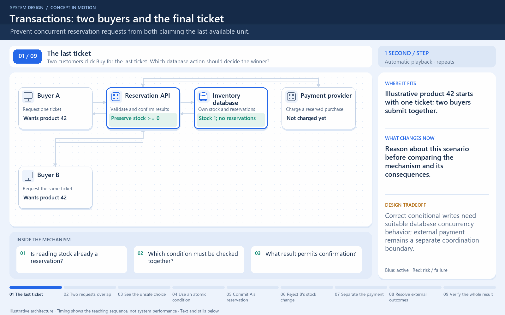

[← Category](README.md) · [Schedule](../../SCHEDULE.md)

<!-- BEGIN INQUIRY -->
## Try solving this first

Two buyers see one ticket. Which single database action should determine who reserves it, and what result permits confirmation?
<!-- END INQUIRY -->

<!-- BEGIN ORIGINAL TOPIC -->
# Transactions

A transaction is a series of database operations that are considered to be a _"single unit of work"_. The operations in a transaction either all succeed, or they all fail. In this way, the notion of a transaction supports data integrity when part of a system fails. Not all databases choose to support ACID transactions, usually because they are prioritizing other optimizations that are hard or theoretically impossible to implement together.

_Usually, relational databases support ACID transactions, and non-relational databases don't (there are exceptions)._

## States

A transaction in a database can be in one of the following states:

### Active

In this state, the transaction is being executed. This is the initial state of every transaction.

### Partially Committed

When a transaction executes its final operation, it is said to be in a partially committed state.

### Committed

If a transaction executes all its operations successfully, it is said to be committed. All its effects are now permanently established on the database system.

### Failed

The transaction is said to be in a failed state if any of the checks made by the database recovery system fails. A failed transaction can no longer proceed further.

### Aborted

If any of the checks fail and the transaction has reached a failed state, then the recovery manager rolls back all its write operations on the database to bring the database back to its original state where it was prior to the execution of the transaction. Transactions in this state are aborted.

The database recovery module can select one of the two operations after a transaction aborts:

- Restart the transaction
- Kill the transaction

### Terminated

If there isn't any roll-back or the transaction comes from the _committed state_, then the system is consistent and ready for a new transaction and the old transaction is terminated.
<!-- END ORIGINAL TOPIC -->

<!-- BEGIN ANIMATION -->
## Watch the sequence

[Read the numbered steps](../../animations/atomic-stock.md) · [View the still sequence](../../assets/animations/atomic-stock-steps.png)
<!-- END ANIMATION -->

## Make it concrete

Reading stock does not reserve it. A transaction boundary alone does not prevent overselling; isolation and statements matter.

Atomically run `UPDATE stock SET quantity = quantity - 1 WHERE product_id = ? AND quantity > 0`. Check affected rows before confirming success; commit related reservation changes together.

Keep transactions short and retry conflicts safely. External payment needs separate coordination.

### Walk through the race

Two buyers both read quantity 1. If each later writes quantity 0 and confirms a purchase, the final stock value looks plausible even though two orders were accepted. The mistake is treating a read as exclusive ownership.

The conditional update makes the check and decrement one database operation. One buyer changes a row; the other observes zero changed rows. If inserting the reservation fails, the transaction should roll back its stock change too. Check the actual database's isolation and conflict behavior rather than assuming any transaction is serializable.

Keep network calls to external payment systems outside long-held database locks when designing the workflow. Persist a recoverable order state and coordinate external effects separately. **Try again:** a buyer receives a timeout after commit. How can a retry find the original reservation instead of subtracting stock again?

[Next topic in this category](README.md) · [Credits and license](../../ATTRIBUTION.md)
