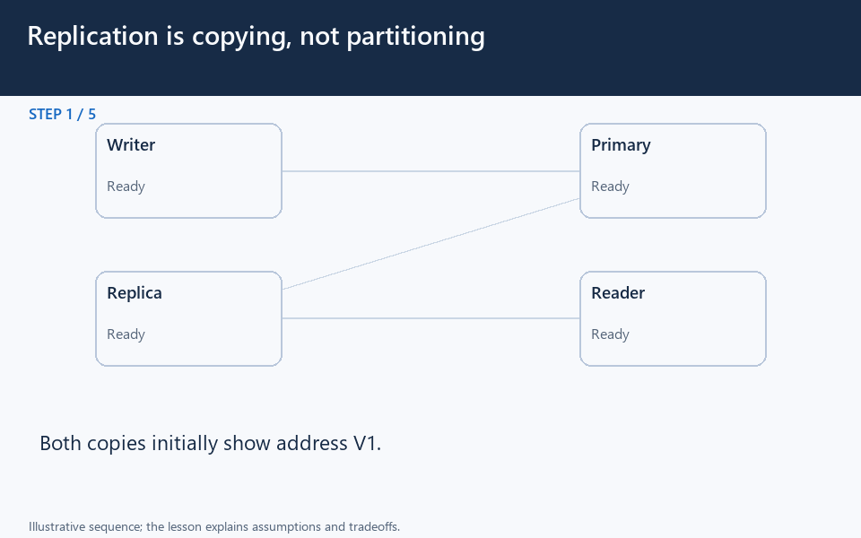

[← Category](README.md) · [Schedule](../../SCHEDULE.md)

<!-- BEGIN INQUIRY -->
## Try solving this first

You save an address and immediately read its old value elsewhere. Which copy answered? Would another live copy also protect you from accidental deletion?
<!-- END INQUIRY -->

<!-- BEGIN ORIGINAL TOPIC -->
# Database Replication

Replication is a process that involves sharing information to ensure consistency between redundant resources such as multiple databases, to improve reliability, fault-tolerance, or accessibility.

## Master-Slave Replication

The master serves reads and writes, replicating writes to one or more slaves, which serve only reads. Slaves can also replicate additional slaves in a tree-like fashion. If the master goes offline, the system can continue to operate in read-only mode until a slave is promoted to a master or a new master is provisioned.

### Advantages

- Backups of the entire database have relatively no impact on the master.
- Applications can read from the slave(s) without impacting the master.
- Slaves can be taken offline and synced back to the master without any downtime.

### Disadvantages

- Replication adds more hardware and additional complexity.
- Downtime and possibly loss of data when a master fails.
- All writes also have to be made to the master in a master-slave architecture.
- The more read slaves, the more we have to replicate, which will increase replication lag.

## Master-Master Replication

Both masters serve reads/writes and coordinate with each other. If either master goes down, the system can continue to operate with both reads and writes.

### Advantages

- Applications can read from both masters.
- Distributes write load across both master nodes.
- Simple, automatic, and quick failover.

### Disadvantages

- Not as simple as master-slave to configure and deploy.
- Either loosely consistent or have increased write latency due to synchronization.
- Conflict resolution comes into play as more write nodes are added and as latency increases.

## Synchronous vs Asynchronous replication

The primary difference between synchronous and asynchronous replication is how the data is written to the replica. In synchronous replication, data is written to primary storage and the replica simultaneously. As such, the primary copy and the replica should always remain synchronized.

In contrast, asynchronous replication copies the data to the replica after the data is already written to the primary storage. Although the replication process may occur in near-real-time, it is more common for replication to occur on a scheduled basis and it is more cost-effective.
<!-- END ORIGINAL TOPIC -->

<!-- BEGIN ANIMATION -->
## Watch the sequence

[Read the numbered steps](../../animations/replication.md) · [View the still sequence](../../assets/animations/replication-steps.png)
<!-- END ANIMATION -->

## Make it concrete

Replication copies data; sharding divides ownership. After a primary commits V2, an asynchronous replica may still return V1.

Route freshness-sensitive reads through the appropriate authoritative protocol; use replicas where their lag is acceptable. Monitor lag and test failover. Waiting for selected replica acknowledgements increases write latency; it does not make every reader always identical.

An accidental deletion can propagate to every live copy. Keep and test historical backups separately.

### Follow one write and two reads

A customer changes an address on the primary and immediately opens the profile page. A read from a lagging replica can show the old address even though the write succeeded. Decide whether that particular user journey needs a read-your-writes rule, an authoritative read, or a visible pending state.

Replicas can distribute read work and support recovery, but the promises depend on the replication and failover protocol. Promoting a stale replica may lose acknowledged updates under some configurations. “There are two copies” does not state which copy can accept writes after a partition.

Measure replication delay and practice recovery with realistic traffic. Keep copies in suitable failure domains, and test backups independently. **Question:** if a valid command accidentally deletes every customer, why would quickly copying that command to all replicas make restoration harder rather than easier?

[Next topic in this category](README.md) · [Credits and license](../../ATTRIBUTION.md)
