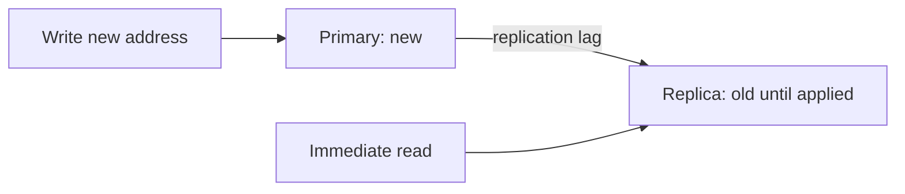

# Database Replication

[← Category](README.md) · [Learning path](../../README.md)

## Read first

Read [Database Replication](../../sources/karan/README.md#database-replication) in the unchanged source course.

## Companion example

Write an address on the primary, then immediately read a lagging replica: the old address may appear. Replication copies data; sharding divides ownership of data. Neither automatically substitutes for backups.

Self-check: what happens if an accidental deletion is copied to every replica?

## Continue

Return to the [category sequence](README.md) and mark your [daily schedule](../../SCHEDULE.md).
