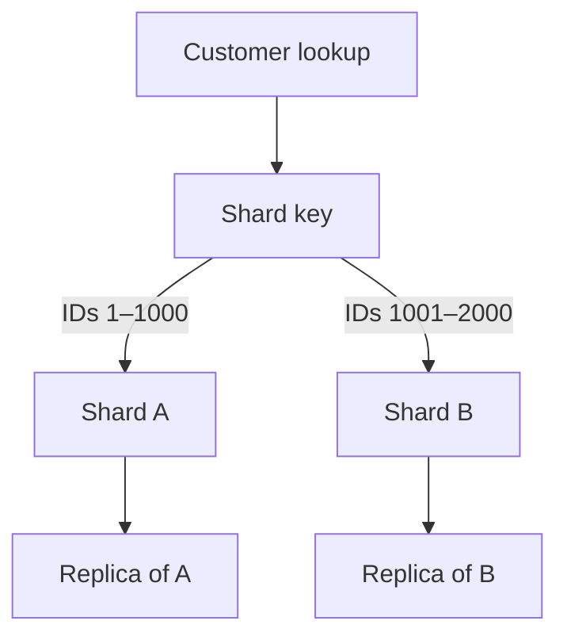

# Sharding

[← Category](README.md) · [Learning path](../../README.md)

## Read first

Read [Sharding](../../sources/karan/README.md#sharding) in the unchanged source course.

## Companion example

Customers 1–1000 live on shard A and 1001–2000 on B. Replicas of A hold the same customer range; B holds a different range. Cross-shard joins and uneven traffic become design concerns.

Self-check: if one celebrity receives half the traffic, does dividing users equally guarantee balanced load?

## Continue

Return to the [category sequence](README.md) and mark your [daily schedule](../../SCHEDULE.md).
