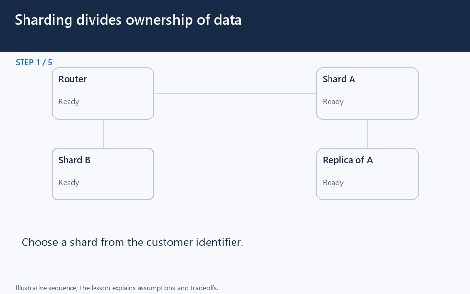

[← Category](README.md) · [Schedule](../../SCHEDULE.md)

<!-- BEGIN INQUIRY -->
## Try solving this first

Billing and catalog teams need independent databases. How will a checkout read both without assuming their writes and recovery happen together?
<!-- END INQUIRY -->

<!-- BEGIN ORIGINAL TOPIC -->
# Database Federation

Federation (or functional partitioning) splits up databases by function. The federation architecture makes several distinct physical databases appear as one logical database to end-users.

All of the components in a federation are tied together by one or more federal schemas that express the commonality of data throughout the federation. These federated schemas are used to specify the information that can be shared by the federation components and to provide a common basis for communication among them.

Federation also provides a cohesive, unified view of data derived from multiple sources. The data sources for federated systems can include databases and various other forms of structured and unstructured data.

## Characteristics

Let's look at some key characteristics of a federated database:

- **Transparency**: Federated database masks user differences and implementations of underlying data sources. Therefore, the users do not need to be aware of where the data is stored.
- **Heterogeneity**: Data sources can differ in many ways. A federated database system can handle different hardware, network protocols, data models, etc.
- **Extensibility**: New sources may be needed to meet the changing needs of the business. A good federated database system needs to make it easy to add new sources.
- **Autonomy**: A Federated database does not change existing data sources, interfaces should remain the same.
- **Data integration**: A federated database can integrate data from different protocols, database management systems, etc.

## Advantages

Here are some advantages of federated databases:

- Flexible data sharing.
- Autonomy among the database components.
- Access heterogeneous data in a unified way.
- No tight coupling of applications with legacy databases.

## Disadvantages

Below are some disadvantages of federated databases:

- Adds more hardware and additional complexity.
- Joining data from two databases is complex.
- Dependence on autonomous data sources.
- Query performance and scalability.
<!-- END ORIGINAL TOPIC -->

<!-- BEGIN ANIMATION -->
## Watch the sequence

[Read the numbered steps](../../animations/sharding.md) · [View the still sequence](../../assets/animations/sharding-steps.png)
<!-- END ANIMATION -->

## Make it concrete

Functional partitioning separates databases by business domain; federation can also provide unified queries across autonomous stores. Sharding instead divides a dataset by key.

Assign each fact an owner and define cross-domain reads and updates. Consider a read model instead of repeated remote joins, with explicit freshness rules. Independent stores also need coordinated backups and recovery.

### Separate ownership before separating machines

Imagine orders and catalog teams operating their own databases. An order stores a product identifier and the purchase-time price; the catalog owns the current description. A screen needing both must decide how to compose the results and what to show when catalog data is unavailable.

Splitting by business responsibility can let teams evolve their data independently. It also removes the assumption that one local transaction or join covers every fact. A reporting layer may unify queries, but it cannot erase network delay or conflicting ownership rules.

For frequent cross-domain reads, a derived view can reduce repeated calls if its update delay is acceptable. For infrequent operations, simple service calls may be easier to maintain. **Try again:** if the catalog changes a price, should yesterday's order total change? Define what each stored value means before synchronizing it.

[Next topic in this category](README.md) · [Credits and license](../../ATTRIBUTION.md)
