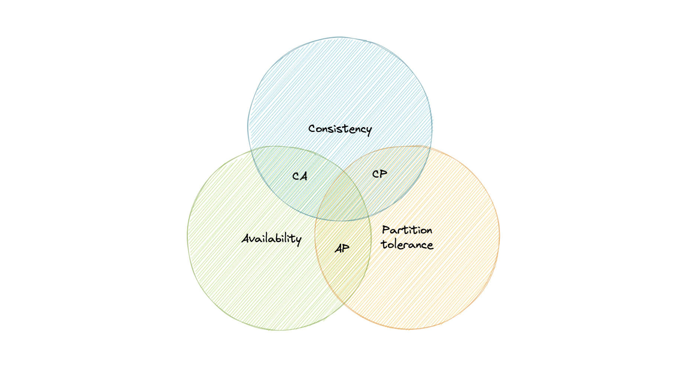
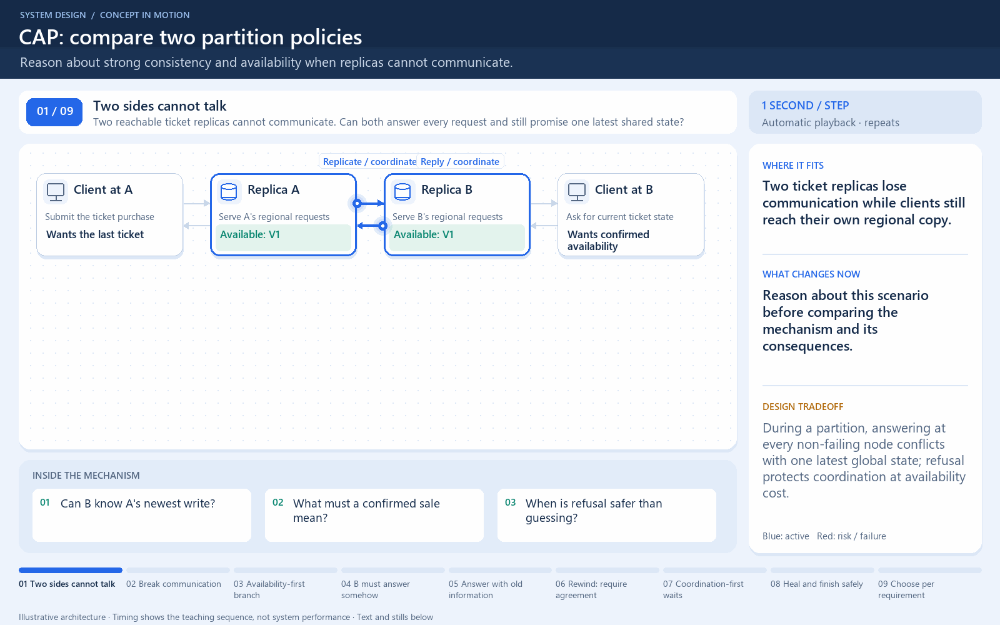

[← Category](README.md) · [Schedule](../../SCHEDULE.md)

> **Reading note:** some statements in the preserved passage need clarification. Read [Make it concrete](#make-it-concrete) with it.

<!-- BEGIN INQUIRY -->
## Try solving this first

Only one seat remains. Replica A records the sale, then the network link to replica B breaks. A second buyer reaches B, which still sees “available” and cannot ask A. Should B answer, wait, or refuse? Which promise is sacrificed by each choice, and why can no routing trick reveal information that never arrived?
<!-- END INQUIRY -->

<!-- BEGIN ORIGINAL TOPIC -->
# CAP Theorem

CAP theorem states that a distributed system can deliver only two of the three desired characteristics Consistency, Availability, and Partition tolerance (CAP).

Let's take a detailed look at the three distributed system characteristics to which the CAP theorem refers.

### Consistency

Consistency means that all clients see the same data at the same time, no matter which node they connect to. For this to happen, whenever data is written to one node, it must be instantly forwarded or replicated across all the nodes in the system before the write is deemed "successful".

### Availability

Availability means that any client making a request for data gets a response, even if one or more nodes are down.

### Partition tolerance

Partition tolerance means the system continues to work despite message loss or partial failure. A system that is partition-tolerant can sustain any amount of network failure that doesn't result in a failure of the entire network. Data is sufficiently replicated across combinations of nodes and networks to keep the system up through intermittent outages.

## Consistency-Availability Tradeoff

We live in a physical world and can't guarantee the stability of a network, so distributed databases must choose Partition Tolerance (P). This implies a tradeoff between Consistency (C) and Availability (A).

### CA database

A CA database delivers consistency and availability across all nodes. It can't do this if there is a partition between any two nodes in the system, and therefore can't deliver fault tolerance.

**Example**: [PostgreSQL](https://www.postgresql.org), [MariaDB](https://mariadb.org).

### CP database

A CP database delivers consistency and partition tolerance at the expense of availability. When a partition occurs between any two nodes, the system has to shut down the non-consistent node until the partition is resolved.

**Example**: [MongoDB](https://www.mongodb.com), [Apache HBase](https://hbase.apache.org).

### AP database

An AP database delivers availability and partition tolerance at the expense of consistency. When a partition occurs, all nodes remain available but those at the wrong end of a partition might return an older version of data than others. When the partition is resolved, the AP databases typically re-syncs the nodes to repair all inconsistencies in the system.

**Example**: [Apache Cassandra](https://cassandra.apache.org), [CouchDB](https://couchdb.apache.org).
<!-- END ORIGINAL TOPIC -->

<!-- BEGIN ANIMATION -->
## Watch the sequence

[Read the numbered steps](../../animations/cap-partition.md) · [View the still sequence](../../assets/animations/cap-partition-steps.png)
<!-- END ANIMATION -->

## Make it concrete

CAP consistency means one-copy, real-time behavior, not instant forwarding everywhere. Availability requires successful request completion at non-failing nodes; an error does not count. Require an authoritative reservation decision; reject an uncoordinated sale rather than sell twice. Recommendations may tolerate older results. This is a per-operation partition decision, not simply “choose two.”

### Put yourself on the isolated side

Two replicas agree that a ticket is available. They lose communication. A buyer on side A completes a purchase; side B now receives a request. B cannot distinguish “A sold it” from “nothing changed at A” by looking at its old state.

If B returns its old answer as current, the system may violate the promised one-copy, real-time behavior. If B waits or rejects a request that its nonfailed node received, it gives up CAP availability for that request. The problem is missing information, not a lack of clever routing.

State the requirement for the operation first. A briefly old profile may be tolerable; selling the same seat twice is a different consequence. CAP's availability definition is not a monthly uptime percentage, and the theorem does not mean choosing any two desirable properties forever. **Check:** what can B truthfully promise while it cannot learn A's state?

[Next topic in this category](README.md) · [Credits and license](../../ATTRIBUTION.md)
