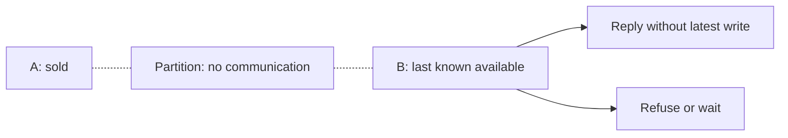

[← Category](README.md) · [Schedule](../../SCHEDULE.md)

<!-- BEGIN ORIGINAL TOPIC -->
# CAP Theorem

CAP theorem states that a distributed system can deliver only two of the three desired characteristics Consistency, Availability, and Partition tolerance (CAP).

Let's take a detailed look at the three distributed system characteristics to which the CAP theorem refers.

### Consistency

Consistency means that all clients see the same data at the same time, no matter which node they connect to. For this to happen, whenever data is written to one node, it must be instantly forwarded or replicated across all the nodes in the system before the write is deemed "successful".

### Availability

Availability means that any client making a request for data gets a response, even if one or more nodes are down.

### Partition tolerance

Partition tolerance means the system continues to work despite message loss or partial failure. A system that is partition-tolerant can sustain any amount of network failure that doesn't result in a failure of the entire network. Data is sufficiently replicated across combinations of nodes and networks to keep the system up through intermittent outages.

## Consistency-Availability Tradeoff

We live in a physical world and can't guarantee the stability of a network, so distributed databases must choose Partition Tolerance (P). This implies a tradeoff between Consistency (C) and Availability (A).

### CA database

A CA database delivers consistency and availability across all nodes. It can't do this if there is a partition between any two nodes in the system, and therefore can't deliver fault tolerance.

**Example**: [PostgreSQL](https://www.postgresql.org), [MariaDB](https://mariadb.org).

### CP database

A CP database delivers consistency and partition tolerance at the expense of availability. When a partition occurs between any two nodes, the system has to shut down the non-consistent node until the partition is resolved.

**Example**: [MongoDB](https://www.mongodb.com), [Apache HBase](https://hbase.apache.org).

### AP database

An AP database delivers availability and partition tolerance at the expense of consistency. When a partition occurs, all nodes remain available but those at the wrong end of a partition might return an older version of data than others. When the partition is resolved, the AP databases typically re-syncs the nodes to repair all inconsistencies in the system.

**Example**: [Apache Cassandra](https://cassandra.apache.org), [CouchDB](https://couchdb.apache.org).
<!-- END ORIGINAL TOPIC -->

## Make it concrete

Two replicas cannot communicate. A client writes “sold” on A; B receives a read. B can answer without confirming the latest write, or refuse/wait. CAP’s availability concerns every request to a non-failing node during a partition, not monthly uptime.

Self-check: which guarantee does each choice sacrifice during that partition?

[Next topic in this category](README.md) · [Credits and license](../../ATTRIBUTION.md)
