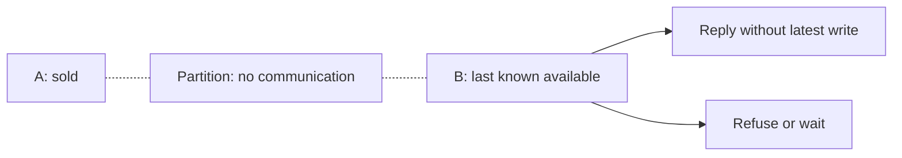

# CAP Theorem

[← Category](README.md) · [Learning path](../../README.md)

## Read first

Read [CAP Theorem](../../sources/karan/README.md#cap-theorem) in the unchanged source course.

## Companion example

Two replicas cannot communicate. A client writes “sold” on A; B receives a read. B can answer without confirming the latest write, or refuse/wait. CAP’s availability concerns every request to a non-failing node during a partition, not monthly uptime.

Self-check: which guarantee does each choice sacrifice during that partition?

## Continue

Return to the [category sequence](README.md) and mark your [daily schedule](../../SCHEDULE.md).
