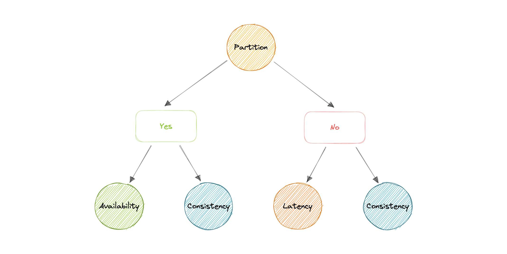
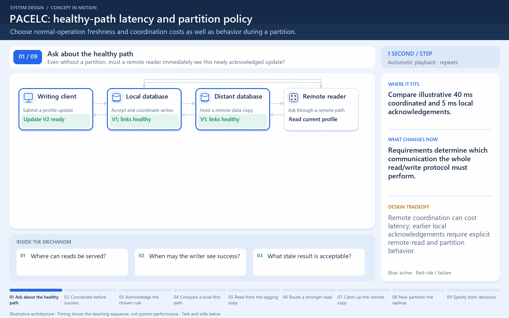

[← Category](README.md) · [Schedule](../../SCHEDULE.md)

<!-- BEGIN INQUIRY -->
## Try solving this first

Your app writes a profile in Mumbai and immediately reads it in London. Waiting for both regions makes the update feel slow; acknowledging locally makes London briefly show the old value. Then the regions lose contact entirely. What tradeoff exists on the normal day, and what different choice appears during the partition?
<!-- END INQUIRY -->

<!-- BEGIN ORIGINAL TOPIC -->
# PACELC Theorem

The PACELC theorem is an extension of the CAP theorem. The CAP theorem states that in the case of network partitioning (P) in a distributed system, one has to choose between Availability (A) and Consistency (C).

PACELC extends the CAP theorem by introducing latency (L) as an additional attribute of a distributed system. The theorem states that else (E), even when the system is running normally in the absence of partitions, one has to choose between latency (L) and consistency (C).

_The PACELC theorem was first described by [Daniel J. Abadi](https://scholar.google.com/citations?user=zxeEF2gAAAAJ)._

PACELC theorem was developed to address a key limitation of the CAP theorem as it makes no provision for performance or latency.

For example, according to the CAP theorem, a database can be considered available if a query returns a response after 30 days. Obviously, such latency would be unacceptable for any real-world application.
<!-- END ORIGINAL TOPIC -->

<!-- BEGIN ANIMATION -->
## Watch the sequence

[Read the numbered steps](../../animations/pacelc.md) · [View the still sequence](../../assets/animations/pacelc-steps.png)
<!-- END ANIMATION -->

## Make it concrete

PACELC includes normal-operation latency versus consistency, not only partition behavior. Permit stale regional profiles when acceptable; coordinate reads requiring freshness. Measure both cases.

### Compare a normal day with a network split

Suppose an account update reaches a nearby region. Waiting for the distant region to participate can add network time. A different design can acknowledge locally and propagate later, but a distant read may then see the previous value. The precise guarantee depends on which replicas coordinate and how reads are performed.

That is the normal-operation tradeoff: even without a partition, the coordination needed for stronger consistency may cost latency. During a partition, ask separately whether an operation must wait or fail to preserve its guarantee, or can continue with weaker visibility.

Use this framework to ask questions about a real configuration rather than stamp a permanent label on a database. Measure a user's full read-after-write journey and the impact of region failures. **Try again:** if you promise immediate global visibility, which network delay have you accepted as part of that promise?

[Next topic in this category](README.md) · [Credits and license](../../ATTRIBUTION.md)
