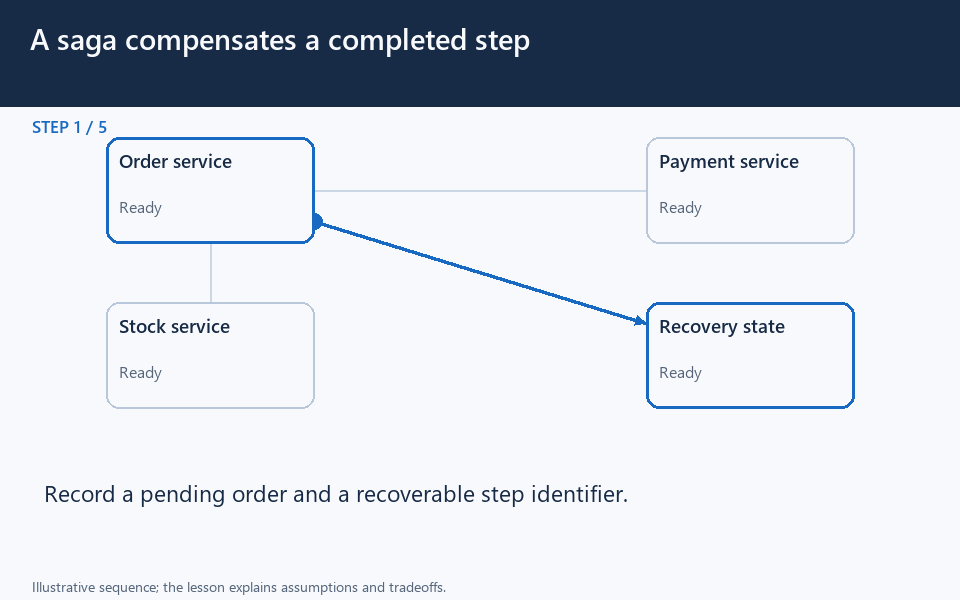

[← Category](README.md) · [Schedule](../../SCHEDULE.md)

<!-- BEGIN INQUIRY -->
## Try solving this first

An order is recorded in one service and charged in another. Then the workflow fails, or the charge response disappears. Can one local database transaction settle everything? When should you retry, wait, or compensate?
<!-- END INQUIRY -->

<!-- BEGIN ORIGINAL TOPIC -->
# Distributed Transactions

A distributed transaction is a set of operations on data that is performed across two or more databases. It is typically coordinated across separate nodes connected by a network, but may also span multiple databases on a single server.

## Why do we need distributed transactions?

Unlike an ACID transaction on a single database, a distributed transaction involves altering data on multiple databases. Consequently, distributed transaction processing is more complicated, because the database must coordinate the committing or rollback of the changes in a transaction as a self-contained unit.

In other words, all the nodes must commit, or all must abort and the entire transaction rolls back. This is why we need distributed transactions.

Now, let's look at some popular solutions for distributed transactions:

## Two-Phase commit

The two-phase commit (2PC) protocol is a distributed algorithm that coordinates all the processes that participate in a distributed transaction on whether to commit or abort (roll back) the transaction.

This protocol achieves its goal even in many cases of temporary system failure and is thus widely used. However, it is not resilient to all possible failure configurations, and in rare cases, manual intervention is needed to remedy an outcome.

This protocol requires a coordinator node, which basically coordinates and oversees the transaction across different nodes. The coordinator tries to establish the consensus among a set of processes in two phases, hence the name.

### Phases

Two-phase commit consists of the following phases:

**Prepare phase**

The prepare phase involves the coordinator node collecting consensus from each of the participant nodes. The transaction will be aborted unless each of the nodes responds that they're _prepared_.

**Commit phase**

If all participants respond to the coordinator that they are _prepared_, then the coordinator asks all the nodes to commit the transaction. If a failure occurs, the transaction will be rolled back.

### Problems

Following problems may arise in the two-phase commit protocol:

- What if one of the nodes crashes?
- What if the coordinator itself crashes?
- It is a blocking protocol.

## Three-phase commit

Three-phase commit (3PC) is an extension of the two-phase commit where the commit phase is split into two phases. This helps with the blocking problem that occurs in the two-phase commit protocol.

### Phases

Three-phase commit consists of the following phases:

**Prepare phase**

This phase is the same as the two-phase commit.

**Pre-commit phase**

Coordinator issues the pre-commit message and all the participating nodes must acknowledge it. If a participant fails to receive this message in time, then the transaction is aborted.

**Commit phase**

This step is also similar to the two-phase commit protocol.

### Why is the Pre-commit phase helpful?

The pre-commit phase accomplishes the following:

- If the participant nodes are found in this phase, that means that _every_ participant has completed the first phase. The completion of prepare phase is guaranteed.
- Every phase can now time out and avoid indefinite waits.

## Sagas

A saga is a sequence of local transactions. Each local transaction updates the database and publishes a message or event to trigger the next local transaction in the saga. If a local transaction fails because it violates a business rule then the saga executes a series of compensating transactions that undo the changes that were made by the preceding local transactions.

### Coordination

There are two common implementation approaches:

- **Choreography**: Each local transaction publishes domain events that trigger local transactions in other services.
- **Orchestration**: An orchestrator tells the participants what local transactions to execute.

### Problems

- The Saga pattern is particularly hard to debug.
- There's a risk of cyclic dependency between saga participants.
- Lack of participant data isolation imposes durability challenges.
- Testing is difficult because all services must be running to simulate a transaction.
<!-- END ORIGINAL TOPIC -->

<!-- BEGIN ANIMATION -->
## Watch the sequence

[Read the numbered steps](../../animations/saga.md) · [View the still sequence](../../assets/animations/saga-steps.png)
<!-- END ANIMATION -->

## Make it concrete

A distributed transaction spans multiple databases. Two-phase commit coordinates participants around a commit decision. A saga commits local steps and compensates when a later step fails. Refunding a charge compensates; it cannot erase an email already delivered.

First list each step, durable outcome, retry rule, and compensation. Record intermediate states such as payment pending. Give repeated commands stable identifiers, and make effects tolerate duplicates. If a charge response is lost, reconcile the provider outcome before creating another charge.

Keep a business invariant inside one owner or transaction when practical. Cross-service coordination adds waiting and recovery work. Durable workflow state lets recovery distinguish failure from an unknown outcome. Measure stuck workflows and provide reconciliation when automation cannot settle them.

### Find the boundary local rollback cannot cross

An order service commits an order; a payment service commits a charge; inventory then says no stock remains. Rolling back the order database does not undo the completed payment. The design needs a way to recover the business workflow across separate commits.

A saga can record progress and request compensating actions, such as refunding the charge. Compensation is another real operation: it can be delayed, retried, or fail. A durable workflow record lets recovery continue after the coordinator restarts. Deduplicate retries at each participant where repeated effects would be harmful.

For work that truly requires a shared atomic decision, examine supported distributed transaction protocols and their coordination costs. For many user-facing workflows, an explicit pending state plus recoverable compensation is a more useful promise than pretending everything is instantaneous. **Check:** what will the customer see while a refund remains unconfirmed?

[Next topic in this category](README.md) · [Credits and license](../../ATTRIBUTION.md)
