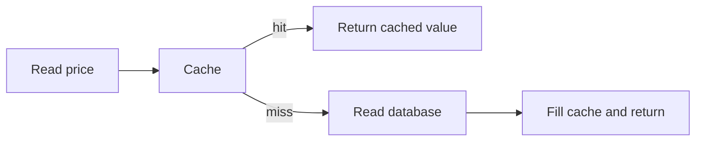

# Caching

[← Category](README.md) · [Learning path](../../README.md)

## Read first

Read [Caching](../../sources/karan/README.md#caching) in the unchanged source course.

## Companion example

Price in database: ₹500. Cache: ₹450. A fast cache hit can still be wrong. Sketch cache-aside: read cache → on miss read database → fill cache. Then trace a price update and decide when the old cache entry disappears.

Self-check: what happens if the database update succeeds but cache invalidation fails?

## Continue

Return to the [category sequence](README.md) and mark your [daily schedule](../../SCHEDULE.md).
