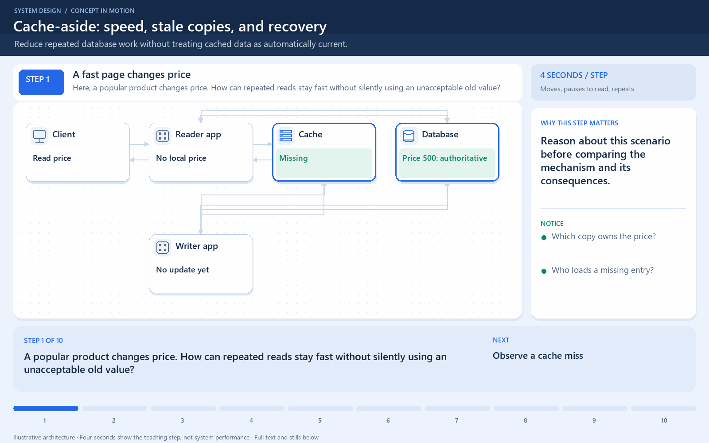

# Caching Strategies

[← Category](README.md) · [Schedule](../../SCHEDULE.md)

<!-- BEGIN INQUIRY -->
## Try solving this first

A popular product is read 100,000 times and updated once. Another value changes every second. The team wants one caching rule for both. Who should load a missing value, who persists a write, and when should a cached copy be updated or removed? What failure could make each policy lie?
<!-- END INQUIRY -->

## Decide who reads and who updates the copy

A cache holds a faster copy of data whose authoritative version lives elsewhere.

| Strategy | Request flow | Main concern |
| --- | --- | --- |
| Cache-aside | Application checks cache; on a miss it reads the database and fills the cache. | Stale entries and simultaneous misses. |
| Read-through | Application reads through a cache layer that loads missing data. | The cache layer owns loading behavior. |
| Write-through | A write goes through a layer that synchronously updates backing storage and cache. | More work on the write path; failures still need handling. |
| Write-behind | A layer accepts the cached write, then persists it later. | Unpersisted writes may be lost if the buffering layer fails. |

Example: a product page uses cache-aside. The first visitor fetches the database value; later visitors use the cached value. A price update must account for the old copy.

Read-through and write-through are not opposites: they describe different sides of access and can be combined.

**Check:** choose a strategy by acceptable staleness, write durability, and who should own loading. “Use a cache” alone does not answer those questions.

## Where this comes into play

Choose an access strategy when repeated work is expensive and you can define how fresh the answer must be. Product descriptions, rendered public pages, and derived query results can have different tolerances from a live account balance.

## Work through a price update

For cache-aside, imagine the database and cache both hold ₹500. A writer commits ₹550 to the database and invalidates the cached entry. A later reader misses, reloads ₹550, and fills the cache. But an earlier slow reader may have read ₹500 before the update and fill that old value after the invalidation. This race is why an invalidation recipe needs a concurrency and freshness model, not just two arrows.

A TTL bounds how long an entry may live according to its policy; it does not prove that every reader sees the latest committed write. A version check, appropriately coordinated update policy, or an authoritative read may be needed for stronger guarantees.

## How to optimize

- Cache results with useful reuse, rather than every response indiscriminately.
- Define keys carefully, including tenant, permissions, or other inputs that change the result.
- Combine duplicate simultaneous loads so one hot miss does not create hundreds of database queries.
- Stagger expirations where appropriate so popular entries do not all miss together.
- Make write-behind durability explicit: acknowledging a buffered update before durable persistence accepts a failure risk unless the buffering system itself provides suitable durability.

Each mechanism adds complexity or cost. A perfectly fresh cache may require enough coordination to lose much of its performance advantage.

## How to verify improvement

Track hit rate, load on the original store, response latency, stale-value incidents, and behavior during cache outages. A high hit rate is not sufficient if private data leaks across cache keys.

<!-- BEGIN ANIMATION -->
## Watch the sequence

[Read the numbered steps](../../animations/cache-aside.md) · [View the still sequence](../../assets/animations/cache-aside-steps.png)
<!-- END ANIMATION -->

## Optional further reading

- [Additional explanation](https://algomaster.io/learn/system-design/caching-strategies)

Optional references provide more detail; they are not required to follow this lesson.
