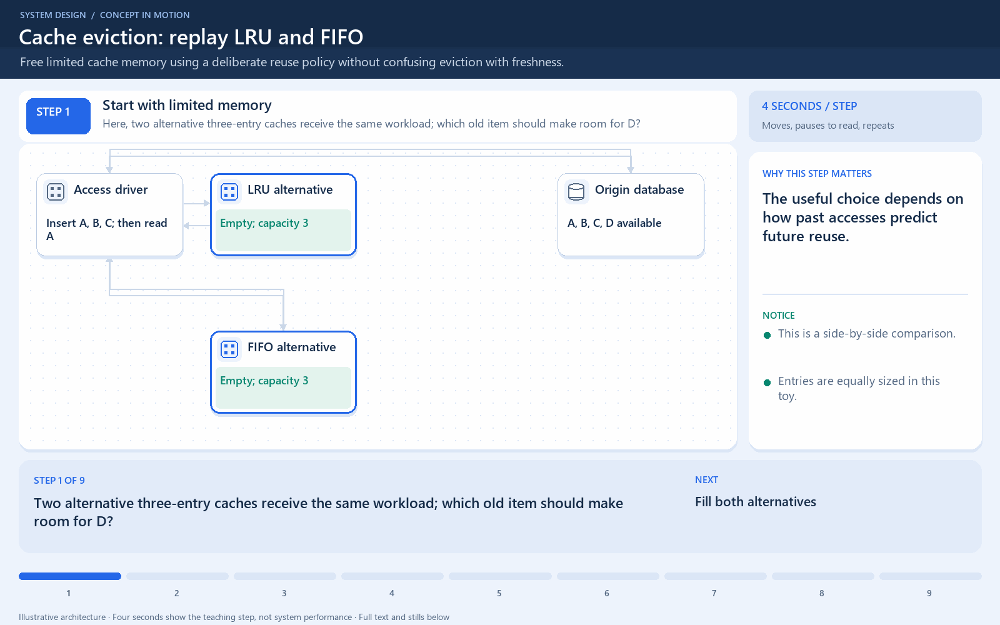

# Cache Eviction Policies

[← Category](README.md) · [Schedule](../../SCHEDULE.md)

## What leaves when the cache is full?

**Eviction** removes entries to make room. **Expiration** removes entries after an age limit, often a TTL, or time to live. Neither alone guarantees that a cached value is still correct after the original changes.

Suppose a cache fits three products: A, B, and C. A is read again, then D needs space.

- **LRU**, least recently used, removes the item unused for the longest time. If B was last read before C, B goes.
- **LFU**, least frequently used, uses access frequency to prefer keeping popular items. Implementations may age old counts.
- **FIFO**, first in, first out, removes the item inserted earliest, regardless of a later read.

LRU works well when recent access predicts future access. A scan across thousands of one-time keys can still push out useful entries. LFU can favor historically popular items even after interest changes unless counts decay.

**Check:** changing the database price requires an update or invalidation policy. Waiting for memory pressure to evict an old price is not a freshness policy.

## Where this comes into play

Eviction matters when the working set—the data actively being reused—is larger than the cache. It determines which potentially useful entries compete for limited memory. It does not decide whether an entry is still correct.

## Walk through a small cache

Assume capacity for three equally sized entries. Insert A, B, C, read A, then insert D. With LRU, B is removed because it was used least recently. With FIFO, A is removed because it was inserted first even though it was just read. LFU needs frequency history and tie-breaking rules before you can predict the victim.

For differently sized entries, counting objects alone can mislead. One huge cached report may displace many small, frequently reused products. A byte-oriented capacity limit and object admission policy can matter as much as the eviction rule.

## How to tune it

Observe whether recent access, repeated frequency, or neither predicts reuse. Test the policy against a realistic access trace, which is a recorded sequence of keys and operations. Include one-time scans, bursts, and changing popularity. Depending on the cache, frequency aging or rejecting oversized, low-reuse entries may help.

TTL tuning is a separate freshness/reuse decision. Very short lifetimes can cause misses even with an excellent eviction policy. Very long lifetimes can preserve stale data unless updates invalidate or refresh it.

## How to verify improvement

Compare hit rate, memory use, origin requests, miss latency, and the cost of tracking access history. Do not declare success solely because LRU or LFU sounds more advanced. A simple policy can be sufficient when the working set fits comfortably.

<!-- BEGIN ANIMATION -->
## Watch the sequence

Open the looping animation

[Read the numbered steps](../../animations/cache-eviction.md) · [View the still sequence](../../assets/animations/cache-eviction-steps.png)
<!-- END ANIMATION -->

## Optional further reading

- [Additional explanation](https://blog.algomaster.io/p/7-cache-eviction-strategies)

Optional references provide more detail; they are not required to follow this lesson.
