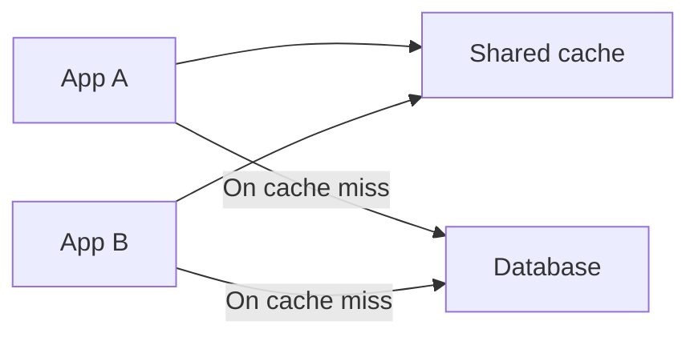

# Distributed Caching

[← Category](README.md) · [Schedule](../../SCHEDULE.md)

## Sharing a fast copy across servers

With a local cache, each application server stores its own copy. A distributed cache is reached over the network and can be shared across application servers; its data may also be spread across several cache nodes.

If App A caches product 42, App B may reuse that entry. This reduces duplicate work and makes cache capacity less dependent on each application's memory. It introduces network latency and another service that can fail.

Plan for a cache outage: can the database absorb misses, or should requests be limited? Plan for a **cache stampede** too: many callers miss the same key at once and all query the database. Coalescing concurrent loads or staggering expiration can help.

Splitting keys evenly does not guarantee even traffic. One viral product can create a hot key.

**Check:** the cache should not silently become the only durable copy of an order unless it was explicitly designed as durable primary storage.

## Optional further reading

- [Additional explanation](https://blog.algomaster.io/p/distributed-caching)

The lesson above is complete enough for this curriculum; external links are for deeper study.
