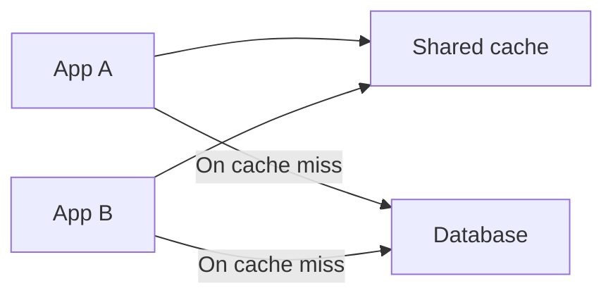
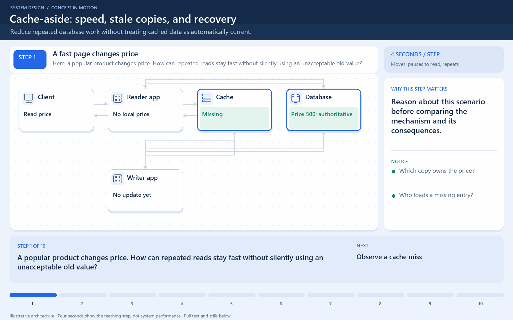

# Distributed Caching

[← Category](README.md) · [Schedule](../../SCHEDULE.md)

<!-- BEGIN INQUIRY -->
## Try solving this first

Ten application servers share one cache. A celebrity post becomes a hot key, one cache node saturates, and a retry storm reaches the database when that node fails. Adding cache capacity did not spread the one key. How should ownership, replication, local copies, and coordinated reloads protect the underlying store?
<!-- END INQUIRY -->

## Sharing a fast copy across servers

With a local cache, each application server stores its own copy. A distributed cache is reached over the network and can be shared across application servers; its data may also be spread across several cache nodes.

If App A caches product 42, App B may reuse that entry. This reduces duplicate work and makes cache capacity less dependent on each application's memory. It introduces network latency and another service that can fail.

Plan for a cache outage: can the database absorb misses, or should requests be limited? Plan for a **cache stampede** too: many callers miss the same key at once and all query the database. Coalescing concurrent loads or staggering expiration can help.

Splitting keys evenly does not guarantee even traffic. One viral product can create a hot key.

**Check:** the cache should not silently become the only durable copy of an order unless it was explicitly designed as durable primary storage.

## Where this comes into play

A shared cache can help a fleet of app instances reuse product data, expensive computed results, or other safely shareable values. Local and shared caches can also be combined, but each extra copy makes freshness and invalidation harder.

## Work through a hot-key failure

Suppose 200 app instances all need one popular product. Its shared-cache entry expires, so all 200 load it from the database at once. Adding cache shards does not automatically spread this one key across them. The bottleneck is the concentrated miss and reload behavior.

A per-key load-coalescing mechanism can let one worker reload while others wait or, where acceptable, briefly use an older value. Any lock or lease used for coordination needs expiry and failure behavior. A stale response is acceptable only if the product requirement permits it.

## How to optimize

Use keys that distribute the actual workload, monitor hot keys, and avoid huge values that dominate network transfer. Consistent hashing can reduce key movement when membership changes, but it does not eliminate popularity skew.

Bound cache timeouts. If the cache is down, an unlimited fallback to the database may overwhelm it. Limit concurrent fallback work or degrade optional responses. Replication and additional cache nodes can improve capacity or resilience but introduce memory cost, coordination, and failure modes.

## How to verify improvement

Measure hit rate per important key class, cache latency, value sizes, origin load, and latency during expiration bursts. Test a node loss and a complete cache outage. An optimization is incomplete if it works only while every cache component is healthy.

<!-- BEGIN ANIMATION -->
## Watch the sequence

[Read the numbered steps](../../animations/cache-aside.md) · [View the still sequence](../../assets/animations/cache-aside-steps.png)
<!-- END ANIMATION -->

## Optional further reading

- [Additional explanation](https://blog.algomaster.io/p/distributed-caching)

Optional references provide more detail; they are not required to follow this lesson.
