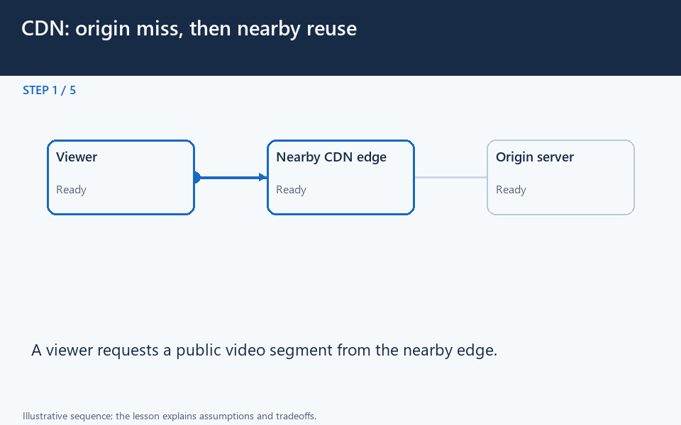

[← Category](README.md) · [Schedule](../../SCHEDULE.md)

<!-- BEGIN INQUIRY -->
## Try solving this first

Viewers in several countries request the same product image from one distant server. Which work can happen closer to them? If you replace the image, why might some viewers still see its old version? Would the same sharing policy be safe for private invoices?
<!-- END INQUIRY -->

<!-- BEGIN ORIGINAL TOPIC -->
# Content Delivery Network (CDN)

A content delivery network (CDN) is a geographically distributed group of servers that work together to provide fast delivery of internet content. Generally, static files such as HTML/CSS/JS, photos, and videos are served from CDN.

## Why use a CDN?

Content Delivery Network (CDN) increases content availability and redundancy while reducing bandwidth costs and improving security. Serving content from CDNs can significantly improve performance as users receive content from data centers close to them and our servers do not have to serve requests that the CDN fulfills.

## How does a CDN work?

In a CDN, the origin server contains the original versions of the content while the edge servers are numerous and distributed across various locations around the world.

To minimize the distance between the visitors and the website's server, a CDN stores a cached version of its content in multiple geographical locations known as edge locations. Each edge location contains several caching servers responsible for content delivery to visitors within its proximity.

Once the static assets are cached on all the CDN servers for a particular location, all subsequent website visitor requests for static assets will be delivered from these edge servers instead of the origin, thus reducing the origin load and improving scalability.

For example, when someone in the UK requests our website which might be hosted in the USA, they will be served from the closest edge location such as the London edge location. This is much quicker than having the visitor make a complete request to the origin server which will increase the latency.

## Types

CDNs are generally divided into two types:

### Push CDNs

Push CDNs receive new content whenever changes occur on the server. We take full responsibility for providing content, uploading directly to the CDN, and rewriting URLs to point to the CDN. We can configure when content expires and when it is updated. Content is uploaded only when it is new or changed, minimizing traffic, but maximizing storage.

Sites with a small amount of traffic or sites with content that isn't often updated work well with push CDNs. Content is placed on the CDNs once, instead of being re-pulled at regular intervals.

### Pull CDNs

In a Pull CDN situation, the cache is updated based on request. When the client sends a request that requires static assets to be fetched from the CDN if the CDN doesn't have it, then it will fetch the newly updated assets from the origin server and populate its cache with this new asset, and then send this new cached asset to the user.

Contrary to the Push CDN, this requires less maintenance because cache updates on CDN nodes are performed based on requests from the client to the origin server. Sites with heavy traffic work well with pull CDNs, as traffic is spread out more evenly with only recently-requested content remaining on the CDN.

## Disadvantages

As we all know good things come with extra costs, so let's discuss some disadvantages of CDNs:

- **Extra charges**: It can be expensive to use a CDN, especially for high-traffic services.
- **Restrictions**: Some organizations and countries have blocked the domains or IP addresses of popular CDNs.
- **Location**: If most of our audience is located in a country where the CDN has no servers, the data on our website may have to travel further than without using any CDN.

## Examples

Here are some widely used CDNs:

- [Amazon CloudFront](https://aws.amazon.com/cloudfront)
- [Google Cloud CDN](https://cloud.google.com/cdn)
- [Cloudflare CDN](https://www.cloudflare.com/cdn)
- [Fastly](https://www.fastly.com/products/cdn)
<!-- END ORIGINAL TOPIC -->

<!-- BEGIN ANIMATION -->
## Watch the sequence

[Read the numbered steps](../../animations/cdn-edge.md) · [View the still sequence](../../assets/animations/cdn-edge-steps.png)
<!-- END ANIMATION -->

## Make it concrete

A CDN keeps reusable content at geographically distributed edge locations. An edge hit avoids another origin transfer; a miss fetches the origin under the selected cache policy.

Start with frequently requested static assets. Define cache keys and cache-control behavior, then use versioned names such as `logo-v2.png` or deliberate invalidation for updates. New origin bytes do not instantly replace every existing edge copy.

Measure hit ratio, origin requests, regional latency, and behavior during an origin outage. A CDN will not automatically fix a slow personalized database query. Keep private invoices out of publicly shared cache entries; signed or authenticated access needs deliberate configuration.

### Decide which bytes can be shared

A shop's product image may be identical for thousands of visitors. Serving a nearby cached copy reduces repeated long-distance transfers and origin work. A private account page has different rules: caching it without a correct key and access policy can expose one person's data to another.

Follow a cold request all the way to the origin, then a later cache hit. Decide how an updated image gets a new identity or invalidates the old copy. A long cache lifetime saves origin traffic but delays changes unless you manage freshness deliberately.

Measure hit rate, origin load, transfer time, and failed revalidations. A high hit rate is useful only if the returned content is correct for the requester. **Question:** if the origin fails, which cached objects can safely remain available, and for how long?

[Next topic in this category](README.md) · [Credits and license](../../ATTRIBUTION.md)
