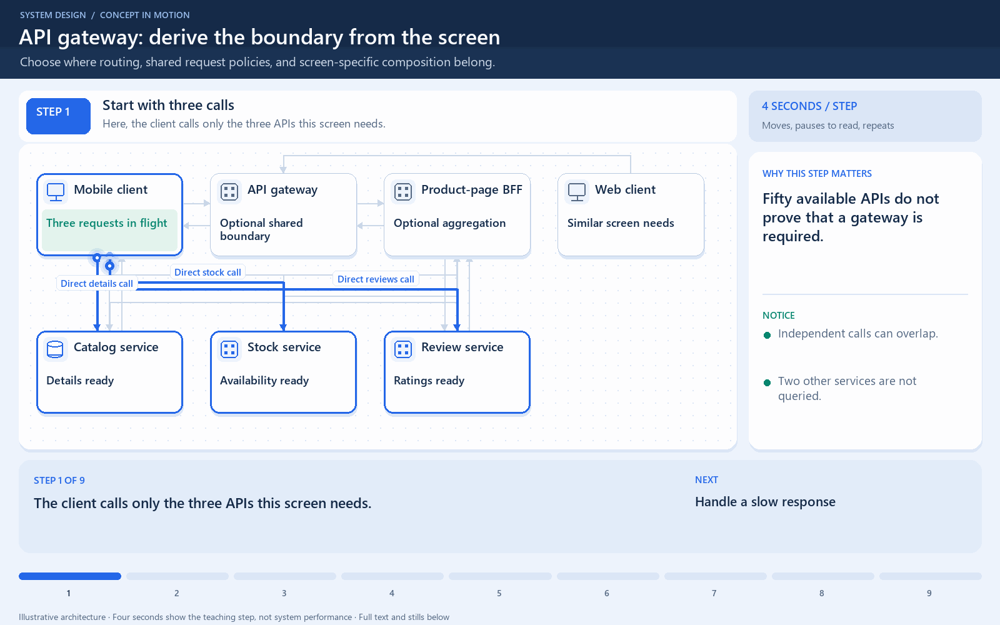

[← Category](README.md) · [Schedule](../../SCHEDULE.md)

<!-- BEGIN INQUIRY -->
## Try solving this first

Your app has five microservices with ten APIs each. One screen needs three APIs from different services. Which calls should the client make? Where could you combine their responses? What should happen if one service is slow?
<!-- END INQUIRY -->

<!-- BEGIN ORIGINAL TOPIC -->
# API Gateway

The API Gateway is an API management tool that sits between a client and a collection of backend services. It is a single entry point into a system that encapsulates the internal system architecture and provides an API that is tailored to each client. It also has other responsibilities such as authentication, monitoring, load balancing, caching, throttling, logging, etc.


## Why do we need an API Gateway?

The granularity of APIs provided by microservices is often different than what a client needs. Microservices typically provide fine-grained APIs, which means that clients need to interact with multiple services. Hence, an API gateway can provide a single entry point for all clients with some additional features and better management.

## Features

Below are some desired features of an API Gateway:

- Authentication and Authorization
- [Service discovery](../09-reliability-and-microservices/01-service-discovery.md)
- [Reverse Proxy](../02-networking/05-proxy.md#reverse-proxy)
- [Caching](../05-caching/01-caching.md)
- Security
- Retry and [Circuit breaking](../09-reliability-and-microservices/03-circuit-breaker.md)
- [Load balancing](../02-networking/08-load-balancing.md)
- Logging, Tracing
- API composition
- [Rate limiting](05-rate-limiting.md) and throttling
- Versioning
- Routing
- IP whitelisting or blacklisting

## Advantages

Let's look at some advantages of using an API Gateway:

- Encapsulates the internal structure of an API.
- Provides a centralized view of the API.
- Simplifies the client code.
- Monitoring, analytics, tracing, and other such features.

## Disadvantages

Here are some possible disadvantages of an API Gateway:

- Possible single point of failure.
- Might impact performance.
- Can become a bottleneck if not scaled properly.
- Configuration can be challenging.

## Backend For Frontend (BFF) pattern

In the Backend For Frontend (BFF) pattern, we create separate backend services to be consumed by specific frontend applications or interfaces. This pattern is useful when we want to avoid customizing a single backend for multiple interfaces. This pattern was first described by [Sam Newman](https://samnewman.io).

Also, sometimes the output of data returned by the microservices to the front end is not in the exact format or filtered as needed by the front end. To solve this issue, the frontend should have some logic to reformat the data, and therefore, we can use BFF to shift some of this logic to the intermediate layer.


The primary function of the backend for the frontend pattern is to get the required data from the appropriate service, format the data, and sent it to the frontend.

_[GraphQL](02-rest-graphql-grpc.md#graphql) performs really well as a backend for frontend (BFF)._

### When to use this pattern?

We should consider using a Backend For Frontend (BFF) pattern when:

- A shared or general purpose backend service must be maintained with significant development overhead.
- We want to optimize the backend for the requirements of a specific client.
- Customizations are made to a general-purpose backend to accommodate multiple interfaces.

## Examples

Following are some widely used gateways technologies:

- [Amazon API Gateway](https://aws.amazon.com/api-gateway)
- [Apigee API Gateway](https://cloud.google.com/apigee)
- [Azure API Gateway](https://azure.microsoft.com/en-in/services/api-management)
- [Kong API Gateway](https://konghq.com/kong)
<!-- END ORIGINAL TOPIC -->

## Make it concrete

### Start with the simplest workable design

The client calls only the three APIs it needs, not all fifty. If those calls are independent, it can issue them concurrently. This can be perfectly reasonable for a small application. Fifty available APIs do not, by themselves, prove that another component is needed.

Now change the constraints. The mobile app must know three service addresses, attach credentials, combine results, and decide what to show if stock is slow while product details and reviews arrive. A web app may duplicate that coordination. Internal service changes can force multiple clients to change.

### Derive the responsibility before naming it

An API gateway provides a shared entry point for routing and cross-cutting policies. A client can call stable public routes while the gateway selects the responsible internal services. Shared request limits and authentication checks can live at this boundary. Each service still enforces resource ownership and its business rules.

Routing alone does not turn three responses into one. A BFF or aggregation endpoint can combine this screen’s three results; not every gateway must aggregate, and small systems may not need one.

```text
Client -> public entry -> product-page aggregator
                         |-> catalog: product details
                         |-> stock: availability
                         |-> reviews: rating summary
Client <- page response <- results + explicit partial-failure policy
```

If the client sends three requests through a gateway, it still sent three requests. A composite endpoint changes that interface to one client request, with three downstream calls. It can run independent calls concurrently, but adds processing and a dependency that must be operated.

### Choose what happens under pressure

Give the screen a deadline. Product details might render while reviews are temporarily unavailable; a purchase must not invent stock availability because that service timed out. Keep business rules in their owning services, bound retries according to operation safety, and propagate request identifiers.

Measure gateway delay separately from downstream delay. Replicate the entry point when its failure would otherwise block the required service. **Return to your first sketch:** which responsibility became repetitive or fragile, where did you move it, and what new failure point did that choice create?

[Next topic in this category](README.md) · [Credits and license](../../ATTRIBUTION.md)

<!-- BEGIN ANIMATION -->
## Watch the design emerge



[Read the numbered steps](../../animations/api-gateway.md) · [View the still sequence](../../assets/animations/api-gateway-steps.png)
<!-- END ANIMATION -->
