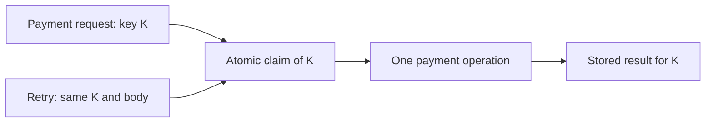

# Idempotency

[← Category](README.md) · [Learning path](../../README.md)

## Read first

Read [Idempotency](../../sources/karan/README.md#idempotency) in the unchanged source course.

## Companion example

A payment succeeds, but the response is lost. The client retries using the same idempotency key. The server must atomically associate the key with one operation/result; merely checking then inserting can race. Reusing the key with a different payment body should be rejected.

Self-check: what happens if two identical retries arrive simultaneously?

## Continue

Return to the [category sequence](README.md) and mark your [daily schedule](../../SCHEDULE.md).
