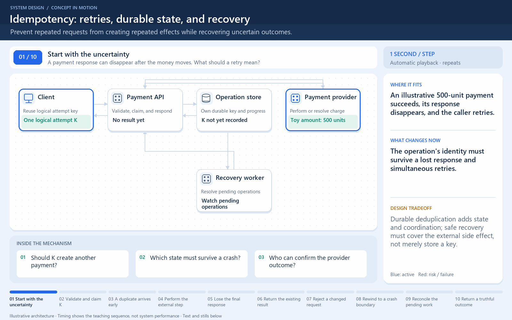

[← Category](README.md) · [Schedule](../../SCHEDULE.md)

<!-- BEGIN INQUIRY -->
## Try solving this first

A ₹500 payment succeeds, but its response disappears. Two identical retries arrive together. How can both return a sensible result without charging twice? What if you record “already handled” and crash before performing the payment?
<!-- END INQUIRY -->

<!-- BEGIN ORIGINAL TOPIC -->
# Idempotency

An operation is idempotent if performing it multiple times has the same effect as performing it once. Setting a user's email to `a@example.com` is idempotent, while _"add $10 to the balance"_ is not, because every repeat changes the result.

In distributed systems, networks drop responses, clients time out, and load balancers retry. As a result, the same request often reaches a server more than once. Idempotency is what makes it safe to retry.

## Why do we need Idempotency?

Consider a client that sends a payment request and the connection times out. The client cannot know whether the server never received the request, processed it but the response was lost, or is still processing it. The only safe way to recover is to retry, but without idempotency a retry can charge the customer twice.

Idempotency is important because:

- It makes retries safe, which is what allows us to build reliable systems on top of unreliable networks.
- Most message brokers offer _at-least-once_ delivery, so consumers will eventually see duplicates.
- It protects against duplicate submissions caused by users double-clicking or refreshing a page.
- It simplifies client logic, as clients can retry aggressively without reasoning about the server's state.

## Idempotency in HTTP

Some HTTP methods are idempotent by definition:

| Method   | Idempotent | Notes                                             |
| -------- | ---------- | ------------------------------------------------- |
| `GET`    | Yes        | Reads data and should not change state.           |
| `PUT`    | Yes        | Replaces a resource with the same representation. |
| `DELETE` | Yes        | Deleting an already deleted resource is a no-op.  |
| `POST`   | No         | Typically creates a new resource on every call.   |
| `PATCH`  | No         | Depends on the patch semantics, e.g. increments.  |

Note that idempotent means the server state is the same after one or many calls, not that the response is identical. For example, a repeated `DELETE` may return `404` instead of `200`.

## Idempotency keys

For operations that are not naturally idempotent, such as `POST /payments`, we can use an _idempotency key_. The client generates a unique value (usually a UUID) and sends it with the request, for example in an `Idempotency-Key` header. The server uses it to detect duplicates.

The flow looks like this:

1. The client generates a unique key and sends it along with the request.
2. The server looks up the key in a datastore.
3. If the key is not found, the server stores it, processes the request, and saves the response against the key.
4. If the key is found, the server skips the processing and returns the saved response.

Some important details to consider:

- **Atomicity**: Checking for the key and recording it must be atomic, otherwise two concurrent retries can both pass the check. A unique constraint in a database or a `SET NX` in [Redis](https://redis.io) can be used for this.
- **Request fingerprint**: We should also store a hash of the request payload. If the same key arrives with a different payload, the server should reject it rather than return an unrelated saved response.
- **In-flight requests**: A retry can arrive while the original is still being processed. The server can return a `409 Conflict` or make the retry wait.
- **Expiry**: Keys don't need to live forever. A retention period of a few hours to a few days is common, and it keeps the storage cost bounded.

## Idempotent consumers

The same idea applies to asynchronous systems. Since message brokers usually guarantee _at-least-once_ delivery, a consumer must handle duplicates. Common approaches are:

- **Deduplication table**: Store the ID of each processed message and skip the message if its ID is already present. The ID should be written in the same transaction as the side effect.
- **Natural idempotency**: Design the operation so that repeating it is harmless, for example _"set status to shipped"_ instead of _"advance status"_.
- **Versioning**: Attach a version or sequence number to updates and ignore any update that is not newer than the current state.

## Tradeoffs

Idempotency is not free. We need extra storage and lookups for keys, and additional logic to handle concurrent and in-flight requests. It is also worth remembering that _exactly-once_ processing is generally not achievable across a network, but _at-least-once_ delivery combined with idempotent processing gives us the same observable result, which is called _effectively-once_ processing.
<!-- END ORIGINAL TOPIC -->

<!-- BEGIN ANIMATION -->
## Watch the sequence

[Read the numbered steps](../../animations/idempotency.md) · [View the still sequence](../../assets/animations/idempotency-steps.png)
<!-- END ANIMATION -->

## Make it concrete

An idempotent operation has the same effect when repeated as when performed once. Scope a payment key K to caller and operation; store a payload fingerprint so K with a different amount is rejected. An atomic uniqueness rule chooses one owner when retries arrive concurrently. Other callers receive the stored result or a defined in-progress response.

Coordinate the key record with the side effect and recovery. Merely checking then inserting can race; recording “done” before unperformed work can silently lose it. Across a provider boundary, use its idempotency contract and reconcile uncertain outcomes.

Retain keys for the supported retry period. Expiring K too early permits an old retry to create new work. Track duplicates and in-progress requests to detect retry storms.

### Design for uncertainty, not only repetition

The client cannot tell whether a lost response means the payment failed or merely that its acknowledgement disappeared. A stable operation key gives a retry a way to identify the same logical attempt. It must be associated durably and atomically with the accepted request; checking for a key and inserting it later leaves a race between simultaneous requests.

An operation still in progress needs an explicit response or recovery path. If the payment provider completed the charge before your local record was updated, recovery must reconcile the same provider operation instead of creating another. Reusing a key with a different request body should not silently apply a new meaning.

**Check:** draw two concurrent retries and a crash immediately after the external side effect. Which durable fact lets every recovery path find the same operation?

[Next topic in this category](README.md) · [Credits and license](../../ATTRIBUTION.md)
