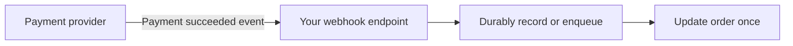
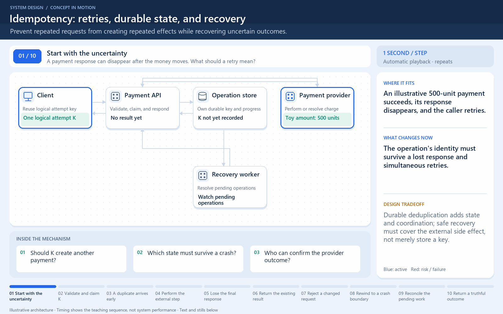

# Webhooks

[← Category](README.md) · [Schedule](../../SCHEDULE.md)

<!-- BEGIN INQUIRY -->
## Try solving this first

Your checkout waits for a payment provider. The provider sends “paid,” receives a timeout, and sends it three more times; the second delivery arrives before an earlier “pending” event. If you simply run the handler each time, customers receive repeated receipts. How will you authenticate, order, deduplicate, retry, and reconcile these callbacks?
<!-- END INQUIRY -->

## Let another system call you when something happens

A webhook is an event notification delivered to an endpoint you provide, commonly using an HTTP request. Instead of repeatedly asking a provider whether payment finished, your application can receive its payment event.

The receiver verifies the sender, validates the event, and handles it safely. A signature check helps establish that the message came from the expected provider. An event identifier helps detect repeated delivery.

A provider may retry if your acknowledgement is lost. Events may also arrive late or in a different order. Consult the provider's delivery contract and make the handler tolerant of duplicates.

Acknowledge only after the event is safely accepted, and move slow processing out of the request path when appropriate. Return success too early and a crash may lose the work; do everything synchronously and you may time out.

**Check:** webhook delivery is not the same thing as a permanently open WebSocket connection.

## Where this comes into play

Webhooks fit notifications between independent services: payment results, repository events, shipment changes, or subscription updates. They avoid constant polling when updates are infrequent, but the receiver must be publicly or otherwise appropriately reachable by the sender.

## Work through a duplicate delivery

The provider sends event E. Your receiver verifies it and durably records E for processing. A response is lost, so the provider sends E again. A uniqueness rule for E plus safe business processing prevents two shipments. Recording an event identifier alone is insufficient if a crash can occur between the record and the business change without a recovery plan.

For delayed or out-of-order events, use a version or state-transition rule, or retrieve the provider's authoritative current status when appropriate. Do not let an old “pending” notification overwrite a known completed payment just because it arrived later.

## How to improve reliability and throughput

Keep the HTTP handling path small: verify, validate, durably accept, and acknowledge according to the provider's contract. Process slow work asynchronously, with bounded retries and a place to inspect repeatedly failing events. Protect the endpoint from oversized or malformed input.

Verify signatures against the provider's specified representation, often the original request bytes. Re-serializing JSON before verification can change those bytes. Where the provider supports freshness checks, use them to reduce replay risk alongside duplicate handling.

## How to verify improvement

Test duplicate, reordered, invalidly signed, delayed, and crash-interrupted events. Measure acceptance latency separately from time until the business update completes, and monitor the oldest unprocessed event.

<!-- BEGIN ANIMATION -->
## Watch the sequence

[Read the numbered steps](../../animations/idempotency.md) · [View the still sequence](../../assets/animations/idempotency-steps.png)
<!-- END ANIMATION -->

## Optional further reading

- [Additional explanation](https://algomaster.io/learn/system-design/webhooks)

Optional references provide more detail; they are not required to follow this lesson.
