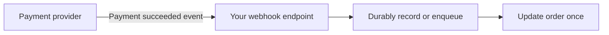

# Webhooks

[← Category](README.md) · [Schedule](../../SCHEDULE.md)

## Let another system call you when something happens

A webhook is an event notification delivered to an endpoint you provide, commonly using an HTTP request. Instead of repeatedly asking a provider whether payment finished, your application can receive its payment event.

The receiver verifies the sender, validates the event, and handles it safely. A signature check helps establish that the message came from the expected provider. An event identifier helps detect repeated delivery.

A provider may retry if your acknowledgement is lost. Events may also arrive late or in a different order. Consult the provider's delivery contract and make the handler tolerant of duplicates.

Acknowledge only after the event is safely accepted, and move slow processing out of the request path when appropriate. Return success too early and a crash may lose the work; do everything synchronously and you may time out.

**Check:** webhook delivery is not the same thing as a permanently open WebSocket connection.

## Optional further reading

- [Additional explanation](https://algomaster.io/learn/system-design/webhooks)

The lesson above is complete enough for this curriculum; external links are for deeper study.
