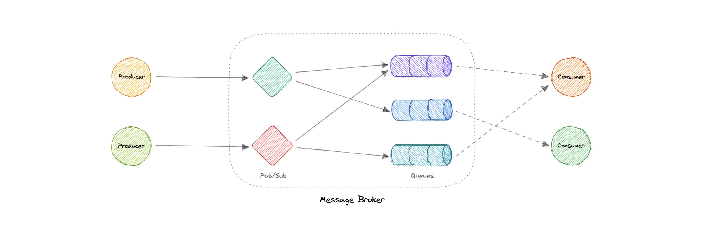

[← Category](README.md) · [Schedule](../../SCHEDULE.md)

> **Reading note:** some statements in the preserved passage need clarification. Read [Make it concrete](#make-it-concrete) with it.

<!-- BEGIN INQUIRY -->
## Try solving this first

The order database commits successfully, but the service crashes one millisecond before publishing “OrderPlaced.” Shipping never learns the order exists. In a different failure, a consumer performs its work and crashes before acknowledging, so the event returns. Where is the durable handoff, when is work complete, and which repeats must be safe?
<!-- END INQUIRY -->

<!-- BEGIN ORIGINAL TOPIC -->
# Message Brokers

A message broker is a software that enables applications, systems, and services to communicate with each other and exchange information. The message broker does this by translating messages between formal messaging protocols. This allows interdependent services to _"talk"_ with one another directly, even if they were written in different languages or implemented on different platforms.

Message brokers can validate, store, route, and deliver messages to the appropriate destinations. They serve as intermediaries between other applications, allowing senders to issue messages without knowing where the receivers are, whether or not they are active, or how many of them there are. This facilitates the decoupling of processes and services within systems.

## Models

Message brokers offer two basic message distribution patterns or messaging styles:

- **[Point-to-Point messaging](02-message-queues.md)**: This is the distribution pattern utilized in message queues with a one-to-one relationship between the message's sender and receiver.
- **[Publish-Subscribe messaging](03-publish-subscribe.md)**: In this message distribution pattern, often referred to as _"pub/sub"_, the producer of each message publishes it to a topic, and multiple message consumers subscribe to topics from which they want to receive messages.

_We will discuss these messaging patterns in detail in the later tutorials._

## Message brokers vs Event streaming

Message brokers can support two or more messaging patterns, including message queues and pub/sub, while event streaming platforms only offer pub/sub-style distribution patterns. Designed for use with high volumes of messages, event streaming platforms are readily scalable. They're capable of ordering streams of records into categories called _topics_ and storing them for a predetermined amount of time. Unlike message brokers, however, event streaming platforms cannot guarantee message delivery or track which consumers have received the messages.

Event streaming platforms offer more scalability than message brokers but fewer features that ensure fault tolerance like message resending, as well as more limited message routing and queueing capabilities.

## Message brokers vs Enterprise Service Bus (ESB)

[Enterprise Service Bus (ESB)](../08-architectural-patterns/06-enterprise-service-bus-esb.md) infrastructure is complex and can be challenging to integrate and expensive to maintain. It's difficult to troubleshoot them when problems occur in production environments, they're not easy to scale, and updating is tedious.

Whereas message brokers are a _"lightweight"_ alternative to ESBs that provide similar functionality, a mechanism for inter-service communication, at a lower cost. They're well-suited for use in the [microservices architectures](../08-architectural-patterns/02-monoliths-and-microservices.md#microservices) that have become more prevalent as ESBs have fallen out of favor.

## Examples

Here are some commonly used message brokers:

- [NATS](https://nats.io)
- [Apache Kafka](https://kafka.apache.org)
- [RabbitMQ](https://www.rabbitmq.com)
- [ActiveMQ](https://activemq.apache.org)
<!-- END ORIGINAL TOPIC -->

<!-- BEGIN ANIMATION -->
## Watch the sequence

[Read the numbered steps](../../animations/work-queue.md) · [View the still sequence](../../assets/animations/work-queue-steps.png)
<!-- END ANIMATION -->

## Make it concrete

A broker stores or routes messages between producers and consumers under configured guarantees. Choose a queue when one worker should perform each job, and independent subscriptions when several business reactions each need the event.

Specify persistence, acknowledgement, ordering, and retry requirements before choosing a product. Streaming platforms can track consumer positions and support delivery guarantees; labels alone do not settle behavior. Batch where added delay is acceptable, bound in-flight work, and monitor backlog age. A consumer crash after a side effect but before acknowledgement can lead to repetition.

### Follow ownership of unfinished work

After an order commits, email delivery can happen later. A broker can separate the order service's pace from the email worker's pace, but first decide what makes the handoff durable. If the service commits an order and crashes before publishing, the broker never saw the event. A recorded publication intent or another suitable atomic handoff mechanism closes that gap.

Next decide when work is acknowledged. Acknowledging before completing a required effect can lose work after a crash; acknowledging afterward can allow duplicate execution. The consumer must handle the selected delivery semantics.

Watch queue age and processing rate, not merely the number of connected workers. More workers help only until a downstream dependency saturates. **Question:** when the broker reconnects after an outage, what limits the recovery burst reaching your email provider?

[Next topic in this category](README.md) · [Credits and license](../../ATTRIBUTION.md)
