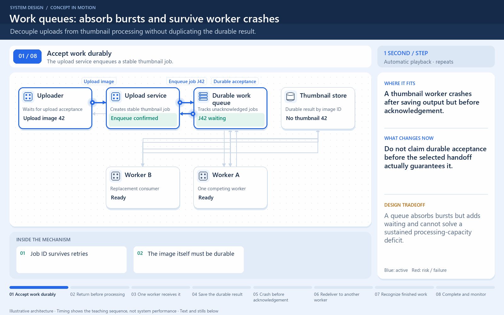

[← Category](README.md) · [Schedule](../../SCHEDULE.md)

> **Reading note:** some statements in the preserved passage need clarification. Read [Make it concrete](#make-it-concrete) with it.

<!-- BEGIN ORIGINAL TOPIC -->
# Message Brokers

A message broker is a software that enables applications, systems, and services to communicate with each other and exchange information. The message broker does this by translating messages between formal messaging protocols. This allows interdependent services to _"talk"_ with one another directly, even if they were written in different languages or implemented on different platforms.

Message brokers can validate, store, route, and deliver messages to the appropriate destinations. They serve as intermediaries between other applications, allowing senders to issue messages without knowing where the receivers are, whether or not they are active, or how many of them there are. This facilitates the decoupling of processes and services within systems.

## Models

Message brokers offer two basic message distribution patterns or messaging styles:

- **[Point-to-Point messaging](02-message-queues.md)**: This is the distribution pattern utilized in message queues with a one-to-one relationship between the message's sender and receiver.
- **[Publish-Subscribe messaging](03-publish-subscribe.md)**: In this message distribution pattern, often referred to as _"pub/sub"_, the producer of each message publishes it to a topic, and multiple message consumers subscribe to topics from which they want to receive messages.

_We will discuss these messaging patterns in detail in the later tutorials._

## Message brokers vs Event streaming

Message brokers can support two or more messaging patterns, including message queues and pub/sub, while event streaming platforms only offer pub/sub-style distribution patterns. Designed for use with high volumes of messages, event streaming platforms are readily scalable. They're capable of ordering streams of records into categories called _topics_ and storing them for a predetermined amount of time. Unlike message brokers, however, event streaming platforms cannot guarantee message delivery or track which consumers have received the messages.

Event streaming platforms offer more scalability than message brokers but fewer features that ensure fault tolerance like message resending, as well as more limited message routing and queueing capabilities.

## Message brokers vs Enterprise Service Bus (ESB)

[Enterprise Service Bus (ESB)](../08-architectural-patterns/06-enterprise-service-bus-esb.md) infrastructure is complex and can be challenging to integrate and expensive to maintain. It's difficult to troubleshoot them when problems occur in production environments, they're not easy to scale, and updating is tedious.

Whereas message brokers are a _"lightweight"_ alternative to ESBs that provide similar functionality, a mechanism for inter-service communication, at a lower cost. They're well-suited for use in the [microservices architectures](../08-architectural-patterns/02-monoliths-and-microservices.md#microservices) that have become more prevalent as ESBs have fallen out of favor.

## Examples

Here are some commonly used message brokers:

- [NATS](https://nats.io)
- [Apache Kafka](https://kafka.apache.org)
- [RabbitMQ](https://www.rabbitmq.com)
- [ActiveMQ](https://activemq.apache.org)
<!-- END ORIGINAL TOPIC -->

<!-- BEGIN ANIMATION -->
## Watch the sequence

Open the looping animation

[Read the numbered steps](../../animations/work-queue.md) · [View the still sequence](../../assets/animations/work-queue-steps.png)
<!-- END ANIMATION -->

## Make it concrete

### A real integration boundary

An order service sends work to messaging infrastructure. Billing and shipping consume it later. The broker stores or routes messages according to its configured guarantees; a queue or topic describes the delivery pattern offered.

### Apply it

Decide whether one worker should perform each job or every independent subscriber should receive the event. Specify persistence, acknowledgement, ordering, and retry requirements before choosing a product.

For throughput, batch messages when the added delay is acceptable. Limit consumers' in-flight work so a fast broker cannot overwhelm a slow database. Track backlog age, not just message count: ten old payment jobs can matter more than thousands of fresh analytics events.

Streaming platforms can track consumer positions and support delivery guarantees; inspect each system’s contract.

**Check:** what happens after a consumer performs work but crashes before acknowledging it?

[Next topic in this category](README.md) · [Credits and license](../../ATTRIBUTION.md)
