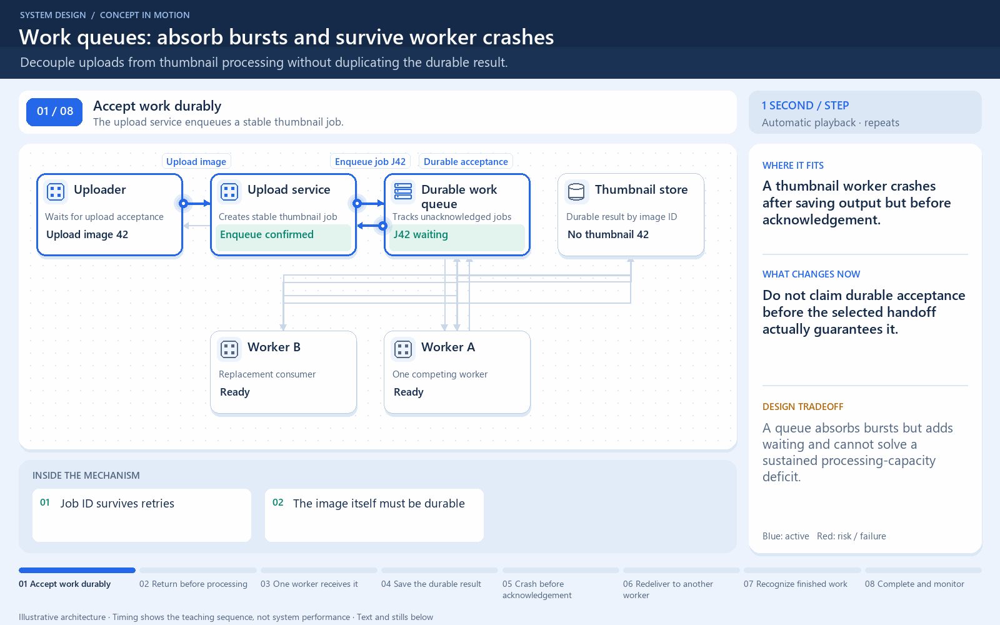

[← Category](README.md) · [Schedule](../../SCHEDULE.md)

> **Reading note:** some statements in the preserved passage need clarification. Read [Make it concrete](#make-it-concrete) with it.

<!-- BEGIN INQUIRY -->
## Try solving this first

A thousand uploads arrive together. Thumbnail generation is slower than upload acceptance. Where should unfinished jobs wait? A worker saves an image and crashes before reporting completion: should the replacement do the work again?
<!-- END INQUIRY -->

<!-- BEGIN ORIGINAL TOPIC -->
# Message Queues

A message queue is a form of service-to-service communication that facilitates asynchronous communication. It asynchronously receives messages from producers and sends them to consumers.

Queues are used to effectively manage requests in large-scale distributed systems. In small systems with minimal processing loads and small databases, writes can be predictably fast. However, in more complex and large systems writes can take an almost non-deterministic amount of time.

## Working

Messages are stored in the queue until they are processed and deleted. Each message is processed only once by a single consumer. Here's how it works:

- A producer publishes a job to the queue, then notifies the user of the job status.
- A consumer picks up the job from the queue, processes it, then signals that the job is complete.

## Advantages

Let's discuss some advantages of using a message queue:

- **Scalability**: Message queues make it possible to scale precisely where we need to. When workloads peak, multiple instances of our application can add all requests to the queue without the risk of collision.
- **Decoupling**: Message queues remove dependencies between components and significantly simplify the implementation of decoupled applications.
- **Performance**: Message queues enable asynchronous communication, which means that the endpoints that are producing and consuming messages interact with the queue, not each other. Producers can add requests to the queue without waiting for them to be processed.
- **Reliability**: Queues make our data persistent, and reduce the errors that happen when different parts of our system go offline.

## Features

Now, let's discuss some desired features of message queues:

### Push or Pull Delivery

Most message queues provide both push and pull options for retrieving messages. Pull means continuously querying the queue for new messages. Push means that a consumer is notified when a message is available. We can also use long-polling to allow pulls to wait a specified amount of time for new messages to arrive.

### FIFO (First-In-First-Out) Queues

In these queues, the oldest (or first) entry, sometimes called the _"head"_ of the queue, is processed first.

### Schedule or Delay Delivery

Many message queues support setting a specific delivery time for a message. If we need to have a common delay for all messages, we can set up a delay queue.

### At-Least-Once Delivery

Message queues may store multiple copies of messages for redundancy and high availability, and resend messages in the event of communication failures or errors to ensure they are delivered at least once.

### Exactly-Once Delivery

When duplicates can't be tolerated, FIFO (first-in-first-out) message queues will make sure that each message is delivered exactly once (and only once) by filtering out duplicates automatically.

### Dead-letter Queues

A dead-letter queue is a queue to which other queues can send messages that can't be processed successfully. This makes it easy to set them aside for further inspection without blocking the queue processing or spending CPU cycles on a message that might never be consumed successfully.

### Ordering

Most message queues provide best-effort ordering which ensures that messages are generally delivered in the same order as they're sent and that a message is delivered at least once.

### Poison-pill Messages

Poison pills are special messages that can be received, but not processed. They are a mechanism used in order to signal a consumer to end its work so it is no longer waiting for new inputs, and are similar to closing a socket in a client/server model.

### Security

Message queues will authenticate applications that try to access the queue, this allows us to encrypt messages over the network as well as in the queue itself.

### Task Queues

Tasks queues receive tasks and their related data, run them, then deliver their results. They can support scheduling and can be used to run computationally-intensive jobs in the background.

## Backpressure

If queues start to grow significantly, the queue size can become larger than memory, resulting in cache misses, disk reads, and even slower performance. Backpressure can help by limiting the queue size, thereby maintaining a high throughput rate and good response times for jobs already in the queue. Once the queue fills up, clients get a server busy or HTTP 503 status code to try again later. Clients can retry the request at a later time, perhaps with [exponential backoff](https://en.wikipedia.org/wiki/Exponential_backoff) strategy.

## Examples

Following are some widely used message queues:

- [Amazon SQS](https://aws.amazon.com/sqs)
- [RabbitMQ](https://www.rabbitmq.com)
- [ActiveMQ](https://activemq.apache.org)
- [ZeroMQ](https://zeromq.org)
<!-- END ORIGINAL TOPIC -->

<!-- BEGIN ANIMATION -->
## Watch the sequence

[Read the numbered steps](../../animations/work-queue.md) · [View the still sequence](../../assets/animations/work-queue-steps.png)
<!-- END ANIMATION -->

## Make it concrete

A work queue buffers jobs for competing consumers, letting uploads return while thumbnails remain pending. A queue absorbs a burst; it cannot fix a sustained arrival rate above processing capacity.

Give each job a stable identifier and deterministic output key. A replacement can recognize complete output instead of creating conflicting duplicates. Acknowledge after durable completion, with explicit processing-timeout or visibility-lease behavior. Partial output needs a recovery rule too.

At-least-once delivery permits repeated execution; one worker per delivery does not imply lifetime exactly-once processing. Increase worker count only while the image store and database have capacity. Bound retries and isolate repeatedly failing jobs. Watch oldest-job age and completion rate, not queue length alone.

### Trace the acknowledgement gap

A worker receives an image-resizing job, stores the result, then crashes before acknowledging. The queue may offer the job again. A second worker cannot infer from delivery alone whether the first attempt completed its effect.

Use a stable job identity and an output or operation record that makes repeated execution safe. Decide how long a job can run before becoming eligible for redelivery, and how a live worker signals progress if the system supports it. Repeated failures need a bounded retry policy and an inspectable failure path rather than an infinite hot loop.

If arrivals exceed sustainable processing, a queue buys time but does not create capacity. Measure oldest-job age and the downstream bottleneck before adding workers. **Check:** what happens to your latency promise after an hour of overload, even if every job remains safely stored?

[Next topic in this category](README.md) · [Credits and license](../../ATTRIBUTION.md)
