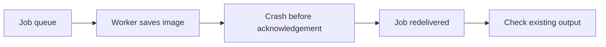

# Message Queues

[← Category](README.md) · [Learning path](../../README.md)

## Read first

Read [Message Queues](../../sources/karan/README.md#message-queues) in the unchanged source course.

## Companion example

Three image workers compete for jobs from one logical queue. A worker crashes after saving an image but before acknowledgement. The job can be delivered again, so processing must tolerate repeats. Acknowledgement timing affects loss and duplication.

Self-check: how can an image job detect that its output already exists?

## Continue

Return to the [category sequence](README.md) and mark your [daily schedule](../../SCHEDULE.md).
