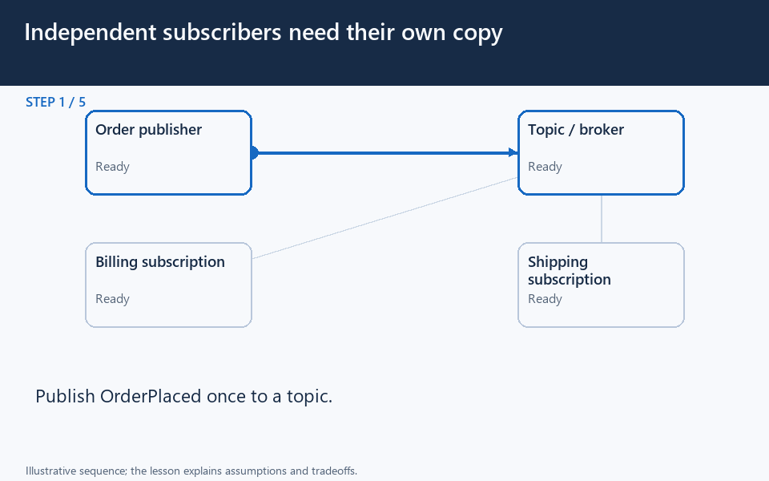
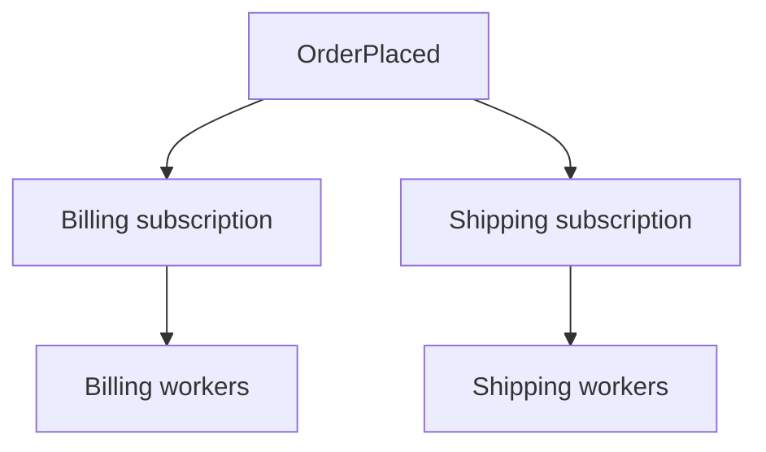

[← Category](README.md) · [Schedule](../../SCHEDULE.md)

> **Reading note:** some statements in the preserved passage need clarification. Read [Make it concrete](#make-it-concrete) with it.

<!-- BEGIN ORIGINAL TOPIC -->
# Publish-Subscribe

Similar to a message queue, publish-subscribe is also a form of service-to-service communication that facilitates asynchronous communication. In a pub/sub model, any message published to a topic is pushed immediately to all the subscribers of the topic.

The subscribers to the message topic often perform different functions, and can each do something different with the message in parallel. The publisher doesn't need to know who is using the information that it is broadcasting, and the subscribers don't need to know where the message comes from. This style of messaging is a bit different than message queues, where the component that sends the message often knows the destination it is sending to.

## Working

Unlike message queues, which batch messages until they are retrieved, message topics transfer messages with little or no queuing and push them out immediately to all subscribers. Here's how it works:

- A message topic provides a lightweight mechanism to broadcast asynchronous event notifications and endpoints that allow software components to connect to the topic in order to send and receive those messages.
- To broadcast a message, a component called a _publisher_ simply pushes a message to the topic.
- All components that subscribe to the topic (known as _subscribers_) will receive every message that was broadcasted.

## Advantages

Let's discuss some advantages of using publish-subscribe:

- **Eliminate Polling**: Message topics allow instantaneous, push-based delivery, eliminating the need for message consumers to periodically check or _"poll"_ for new information and updates. This promotes faster response time and reduces the delivery latency which can be particularly problematic in systems where delays cannot be tolerated.
- **Dynamic Targeting**: Pub/Sub makes the discovery of services easier, more natural, and less error-prone. Instead of maintaining a roster of peers where an application can send messages, a publisher will simply post messages to a topic. Then, any interested party will subscribe its endpoint to the topic, and start receiving these messages. Subscribers can change, upgrade, multiply or disappear and the system dynamically adjusts.
- **Decoupled and Independent Scaling**: Publishers and subscribers are decoupled and work independently from each other, which allows us to develop and scale them independently.
- **Simplify Communication**: The Publish-Subscribe model reduces complexity by removing all the point-to-point connections with a single connection to a message topic, which will manage subscriptions and decide what messages should be delivered to which endpoints.

## Features

Now, let's discuss some desired features of publish-subscribe:

### Push Delivery

Pub/Sub messaging instantly pushes asynchronous event notifications when messages are published to the message topic. Subscribers are notified when a message is available.

### Multiple Delivery Protocols

In the Publish-Subscribe model, topics can typically connect to multiple types of endpoints, such as message queues, serverless functions, HTTP servers, etc.

### Fanout

This scenario happens when a message is sent to a topic and then replicated and pushed to multiple endpoints. Fanout provides asynchronous event notifications which in turn allows for parallel processing.

### Filtering

This feature empowers the subscriber to create a message filtering policy so that it will only get the notifications it is interested in, as opposed to receiving every single message posted to the topic.

### Durability

Pub/Sub messaging services often provide very high durability, and at least once delivery, by storing copies of the same message on multiple servers.

### Security

Message topics authenticate applications that try to publish content, this allows us to use encrypted endpoints and encrypt messages in transit over the network.

## Examples

Here are some commonly used publish-subscribe technologies:

- [Amazon SNS](https://aws.amazon.com/sns)
- [Google Pub/Sub](https://cloud.google.com/pubsub)
<!-- END ORIGINAL TOPIC -->

<!-- BEGIN ANIMATION -->
## Watch the sequence

Open the looping animation

[Read the numbered steps](../../animations/pub-sub.md) · [View the still sequence](../../assets/animations/pub-sub-steps.png)
<!-- END ANIMATION -->

## Make it concrete

### One event, several independent reactions

An OrderPlaced event must reach both billing and shipping. Each needs its own subscription. Several workers inside the billing subscription may share billing work; that does not mean shipping receives its required copy.

### Apply it

Define the event's meaning and versioned fields so consumers do not depend on incidental database details. Give events identifiers and make consumers tolerate retries. Use durable subscriptions or retained history when a temporarily offline consumer must catch up; ephemeral broadcast alone does not guarantee that.

Scale each subscription against its own backlog and downstream capacity. Partition related events consistently when their ordering matters, and avoid assuming a global order across independent partitions. A slow analytics consumer should not need to block payment processing.

Some systems let consumers pull retained records; pub/sub does not inherently require immediate push.

**Check:** if billing and shipping compete on the same work queue, which business action might never happen?

[Next topic in this category](README.md) · [Credits and license](../../ATTRIBUTION.md)
