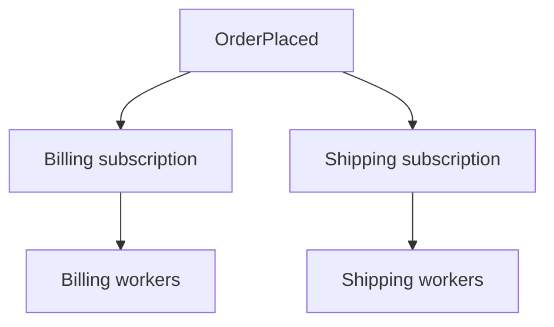

# Publish-Subscribe

[← Category](README.md) · [Learning path](../../README.md)

## Read first

Read [Publish-Subscribe](../../sources/karan/README.md#publish-subscribe) in the unchanged source course.

## Companion example

An OrderPlaced event goes to billing and shipping subscriptions. Each subscription needs its own copy; workers within one subscription may share the work. Distinguish subscribers from competing workers.

Self-check: why would putting billing and shipping workers on one work queue be wrong?

## Continue

Return to the [category sequence](README.md) and mark your [daily schedule](../../SCHEDULE.md).
