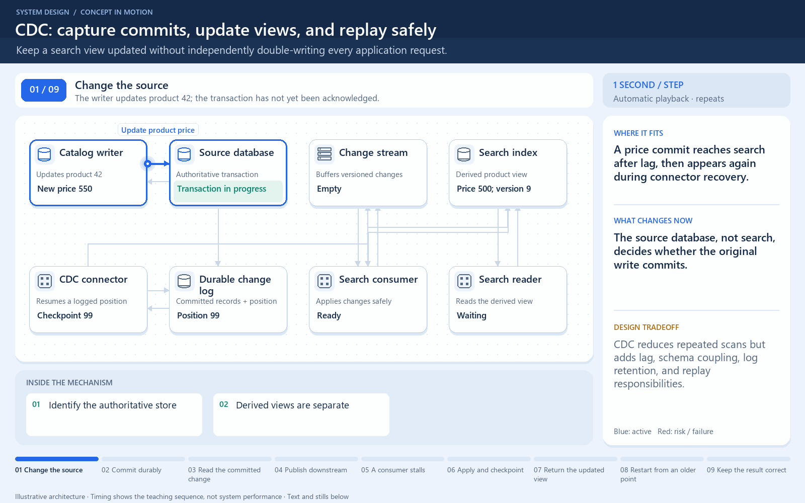

# Change Data Capture (CDC)

[← Category](README.md) · [Schedule](../../SCHEDULE.md)

<!-- BEGIN INQUIRY -->
## Try solving this first

A product price commits in the database, but search still shows the old price because a dual-write to the index failed. Recovery replays the same change twice and an older event arrives late. How can committed changes become a durable stream, how will consumers order or deduplicate them, and which store remains authoritative?
<!-- END INQUIRY -->

## Turn database changes into downstream updates

CDC observes changes in a database and makes them available to other systems. A common implementation reads the database's change log and produces insert, update, and delete records.

Example: a product price changes in the main database. A CDC pipeline carries that change to a search index. Search can then reflect the new price without the application separately writing both systems on every request.

The search index can lag behind the database. A consumer may also see a change again after recovery, so repeated processing must be safe. An initial snapshot, ongoing log position, and restart behavior all matter.

CDC describes changed data, not necessarily business intent. A changed order status row is not automatically the same contract as an explicitly defined OrderShipped event. Schema changes can affect consumers as well.

**Check:** replacing two application writes with CDC removes one coordination pattern; it does not make downstream views instantly consistent or remove the need to handle duplicate changes.

## Where this comes into play

CDC helps keep a search index, analytics store, or other derived view aligned with an operational database. It is useful when downstream consumers need a stream of changes rather than repeated full-table reads.

## Follow one changed price

The database commits a new product price and records the change in its durable log. A connector reads a position in that log and emits a change record. A search consumer updates its index and tracks progress so it can restart. Each stage has its own delay; “committed in the database” does not mean “already visible in search.”

If a consumer restarts from an earlier position, it may process a change again. Updating the search record by stable product identifier and an appropriate version rule can make replay safe. Deletes and schema changes need explicit handling too.

## How to optimize and operate it

Measure lag in both time and log position. Batch suitable downstream writes to reduce overhead, while accepting the additional waiting that batching can introduce. Separate slow consumers where the platform supports it so one blocked destination does not unnecessarily stop others.

Keep retained-log and replication-slot behavior under observation. Some systems retain changes for a lagging consumer, which can consume substantial storage if that consumer stops. Plan initial snapshots, restart positions, and what to do if required log history is no longer available.

## How to verify improvement

Test replay, connector downtime, a large initial snapshot, deletion, schema evolution, and destination failure. Compare downstream freshness, source overhead, retained-log size, and whether restarting produces missing or duplicated business effects.

<!-- BEGIN ANIMATION -->
## Watch the sequence

[Read the numbered steps](../../animations/cdc.md) · [View the still sequence](../../assets/animations/cdc-steps.png)
<!-- END ANIMATION -->

## Optional further reading

- [Additional explanation](https://algomaster.io/learn/system-design/change-data-capture-cdc)
- [PostgreSQL: logical decoding](https://www.postgresql.org/docs/current/logicaldecoding-explanation.html)

Optional references provide more detail; they are not required to follow this lesson.
