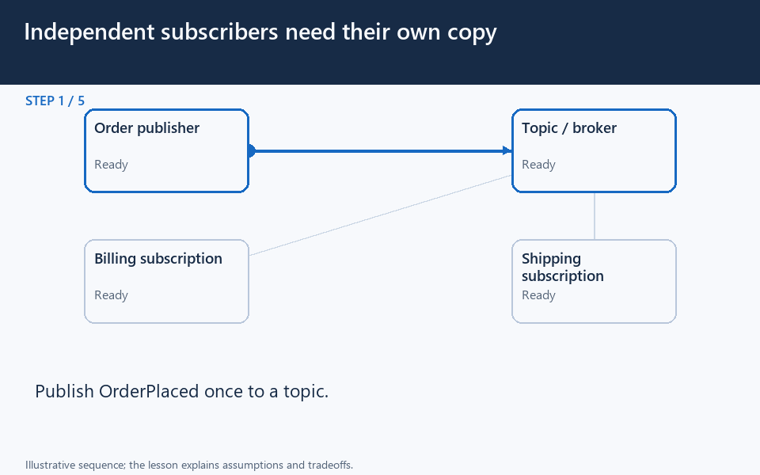

[← Category](README.md) · [Schedule](../../SCHEDULE.md)

<!-- BEGIN ORIGINAL TOPIC -->
# Event-Driven Architecture (EDA)

Event-Driven Architecture (EDA) is about using events as a way to communicate within a system. Generally, leveraging a message broker to publish and consume events asynchronously. The publisher is unaware of who is consuming an event and the consumers are unaware of each other. Event-Driven Architecture is simply a way of achieving loose coupling between services within a system.

## What is an event?

An event is a data point that represents state changes in a system. It doesn't specify what should happen and how the change should modify the system, it only notifies the system of a particular state change. When a user makes an action, they trigger an event.

## Components

Event-driven architectures have three key components:

- **Event producers**: Publishes an event to the router.
- **Event routers**: Filters and pushes the events to consumers.
- **Event consumers**: Uses events to reflect changes in the system.

_Note: Dots in the diagram represents different events in the system._

## Patterns

There are several ways to implement the event-driven architecture, and which method we use depends on the use case but here are some common examples:

- [Sagas](../04-distributed-data/03-distributed-transactions.md#sagas)
- [Publish-Subscribe](../07-asynchronous-communication/03-publish-subscribe.md)
- [Event Sourcing](04-event-sourcing.md)
- [Command and Query Responsibility Segregation (CQRS)](05-command-and-query-responsibility-segregation-cqrs.md)

_Note: Each of these methods is discussed separately._

## Advantages

Let's discuss some advantages:

- Decoupled producers and consumers.
- Highly scalable and distributed.
- Easy to add new consumers.
- Improves agility.

## Challenges

Here are some challenges of event-drive architecture:

- Guaranteed delivery.
- Error handling is difficult.
- Event-driven systems are complex in general.
- Exactly once, in-order processing of events.

## Use cases

Below are some common use cases where event-driven architectures are beneficial:

- Metadata and metrics.
- Server and security logs.
- Integrating heterogeneous systems.
- Fanout and parallel processing.

## Examples

Here are some widely used technologies for implementing event-driven architectures:

- [NATS](https://nats.io)
- [Apache Kafka](https://kafka.apache.org)
- [Amazon EventBridge](https://aws.amazon.com/eventbridge)
- [Amazon SNS](https://aws.amazon.com/sns)
- [Google PubSub](https://cloud.google.com/pubsub)
<!-- END ORIGINAL TOPIC -->

<!-- BEGIN ANIMATION -->
## Watch the sequence

Open the looping animation

[Read the numbered steps](../../animations/pub-sub.md) · [View the still sequence](../../assets/animations/pub-sub-steps.png)
<!-- END ANIMATION -->

## Make it concrete

### An action can finish before its reactions

The order service records an order; shipping reacts to OrderPlaced later. The customer can see “order accepted, shipping pending” while that work is unfinished.

### Apply it

Coordinate recording the order and publishing its event, for example with a transactional outbox, so a crash does not leave an order with no event. Give events identifiers and consumers safe retry behavior. Expect delay and possible reordering.

Scale consumers using backlog age and downstream capacity. More workers do not help if every worker waits on the same overloaded database.

**Check:** how will the order page describe an unprocessed shipping event?

[Next topic in this category](README.md) · [Credits and license](../../ATTRIBUTION.md)
