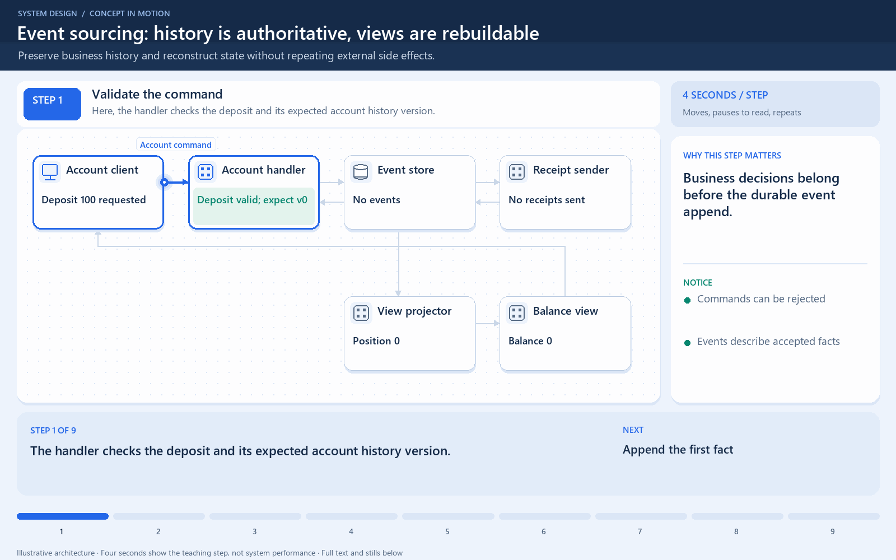

[← Category](README.md) · [Schedule](../../SCHEDULE.md)

<!-- BEGIN INQUIRY -->
## Try solving this first

A balance changed several times, and an auditor asks how it reached 70. Can you reconstruct it? How would rebuilding avoid charging or emailing someone again?
<!-- END INQUIRY -->

<!-- BEGIN ORIGINAL TOPIC -->
# Event Sourcing

Instead of storing just the current state of the data in a domain, use an append-only store to record the full series of actions taken on that data. The store acts as the system of record and can be used to materialize the domain objects.

This can simplify tasks in complex domains, by avoiding the need to synchronize the data model and the business domain, while improving performance, scalability, and responsiveness. It can also provide consistency for transactional data, and maintain full audit trails and history that can enable compensating actions.

## Event sourcing vs Event-Driven Architecture (EDA)

Event sourcing is seemingly constantly being confused with [Event-driven Architecture (EDA)](03-event-driven-architecture-eda.md). Event-driven architecture is about using events to communicate between service boundaries. Generally, leveraging a message broker to publish and consume events asynchronously within other boundaries.

Whereas, event sourcing is about using events as a state, which is a different approach to storing data. Rather than storing the current state, we're instead going to be storing events. Also, event sourcing is one of the several patterns to implement an event-driven architecture.

## Advantages

Let's discuss some advantages of using event sourcing:

- Excellent for real-time data reporting.
- Great for fail-safety, data can be reconstituted from the event store.
- Extremely flexible, any type of message can be stored.
- Preferred way of achieving audit logs functionality for high compliance systems.

## Disadvantages

Following are the disadvantages of event sourcing:

- Requires an extremely efficient network infrastructure.
- Requires a reliable way to control message formats, such as a schema registry.
- Different events will contain different payloads.
<!-- END ORIGINAL TOPIC -->

<!-- BEGIN ANIMATION -->
## Watch the sequence

[Read the numbered steps](../../animations/event-sourcing.md) · [View the still sequence](../../assets/animations/event-sourcing-steps.png)
<!-- END ANIMATION -->

## Make it concrete

Event sourcing makes stored events authoritative, not merely notifications. Deposited(100), then Withdrawn(30), rebuilds balance 70.

Use verified snapshots to shorten replay, retain required history, and version event schemas. Rebuilding state must not repeat external payment or receipt side effects. Replay and auditability add recovery and schema work.

Walk the example twice. On the first replay, applying the two events produces 70. On a later rebuild, the same retained history should reproduce the same intended state rather than create another withdrawal. Email or payment calls are outside that state reconstruction and need their own deliberate execution rules.

A snapshot records a derived state at a known history position. Load it and apply only later events to avoid replaying the entire retained history every time. Verify that the snapshot belongs to the right history and schema version.

Choose this pattern when history and reconstruction are real requirements. Ordinary current-state storage with an audit log can be simpler when it already meets the product's needs. Event history does not make schema changes or recovery automatic.

[Next topic in this category](README.md) · [Credits and license](../../ATTRIBUTION.md)
