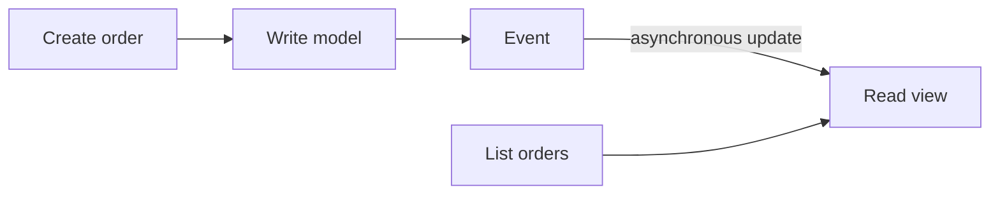

# Command and Query Responsibility Segregation (CQRS)

[← Category](README.md) · [Learning path](../../README.md)

## Read first

Read [Command and Query Responsibility Segregation (CQRS)](../../sources/karan/README.md#command-and-query-responsibility-segregation-cqrs) in the unchanged source course.

## Companion example

An order command updates the write model; an event updates a separate order-list view. The view can lag. CQRS separates write and read responsibilities; it does not require event sourcing.

Self-check: how will a user understand an order temporarily missing from the read view?

## Continue

Return to the [category sequence](README.md) and mark your [daily schedule](../../SCHEDULE.md).
