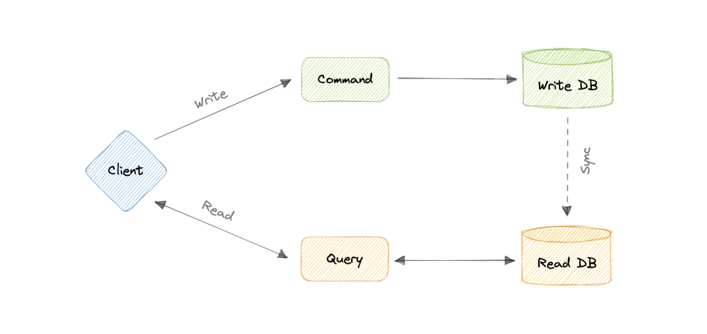
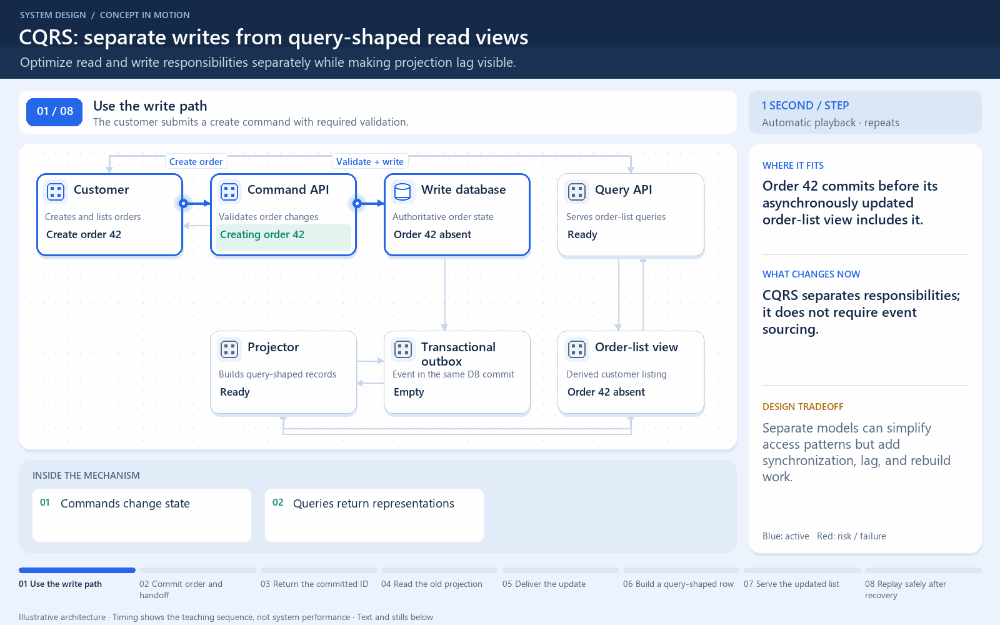

[← Category](README.md) · [Schedule](../../SCHEDULE.md)

<!-- BEGIN INQUIRY -->
## Try solving this first

Writing an order needs strict validation; listing a customer’s orders needs a fast, denormalized view. After creation succeeds, the list briefly omits the new order and support calls it data loss. Should both paths share one model? What lag is acceptable, how is the read view rebuilt, and which system answers authoritative status?
<!-- END INQUIRY -->

<!-- BEGIN ORIGINAL TOPIC -->
# Command and Query Responsibility Segregation (CQRS)

Command Query Responsibility Segregation (CQRS) is an architectural pattern that divides a system's actions into commands and queries. It was first described by [Greg Young](https://twitter.com/gregyoung).

In CQRS, a _command_ is an instruction, a directive to perform a specific task. It is an intention to change something and doesn't return a value, only an indication of success or failure. And, a _query_ is a request for information that doesn't change the system's state or cause any side effects.

The core principle of CQRS is the separation of commands and queries. They perform fundamentally different roles within a system, and separating them means that each can be optimized as needed, which distributed systems can really benefit from.

## CQRS with Event Sourcing

The CQRS pattern is often used along with the Event Sourcing pattern. CQRS-based systems use separate read and write data models, each tailored to relevant tasks and often located in physically separate stores.

When used with the Event Sourcing pattern, the store of events is the write model and is the official source of information. The read model of a CQRS-based system provides materialized views of the data, typically as highly denormalized views.

## Advantages

Let's discuss some advantages of CQRS:

- Allows independent scaling of read and write workloads.
- Easier scaling, optimizations, and architectural changes.
- Closer to business logic with loose coupling.
- The application can avoid complex joins when querying.
- Clear boundaries between the system behavior.

## Disadvantages

Below are some disadvantages of CQRS:

- More complex application design.
- Message failures or duplicate messages can occur.
- Dealing with eventual consistency is a challenge.
- Increased system maintenance efforts.

## Use cases

Here are some scenarios where CQRS will be helpful:

- The performance of data reads must be fine-tuned separately from the performance of data writes.
- The system is expected to evolve over time and might contain multiple versions of the model, or where business rules change regularly.
- Integration with other systems, especially in combination with event sourcing, where the temporal failure of one subsystem shouldn't affect the availability of the others.
- Better security to ensure that only the right domain entities are performing writes on the data.
<!-- END ORIGINAL TOPIC -->

<!-- BEGIN ANIMATION -->
## Watch the sequence

[Read the numbered steps](../../animations/cqrs.md) · [View the still sequence](../../assets/animations/cqrs-steps.png)
<!-- END ANIMATION -->

## Make it concrete

CQRS separates write responsibilities from read views; it does not require event sourcing.

For recent-order screens, project changes into a customer-shaped read model instead of repeatedly joining the write model. Make projection updates duplicate-safe and monitor lag. Return the confirmed order identifier with a pending-view state. Define how a lost read view is rebuilt. Extra models add synchronization work; simple CRUD may not benefit.

Suppose an order is committed at time T, but the projection worker is briefly stopped. The write succeeded even though the read view is behind. A retry of the user's create request must not silently create another order merely because the list looks empty. Use the confirmed identifier to show a useful pending state.

A read model can contain exactly the fields and indexes needed for a customer screen. This can reduce joins and read cost, while adding storage and update work. Keep the source of rebuild data explicit; CQRS alone does not guarantee an event history exists. Test a stopped projector, duplicate changes, and reconstruction before claiming the split improved the design.

[Next topic in this category](README.md) · [Credits and license](../../ATTRIBUTION.md)
