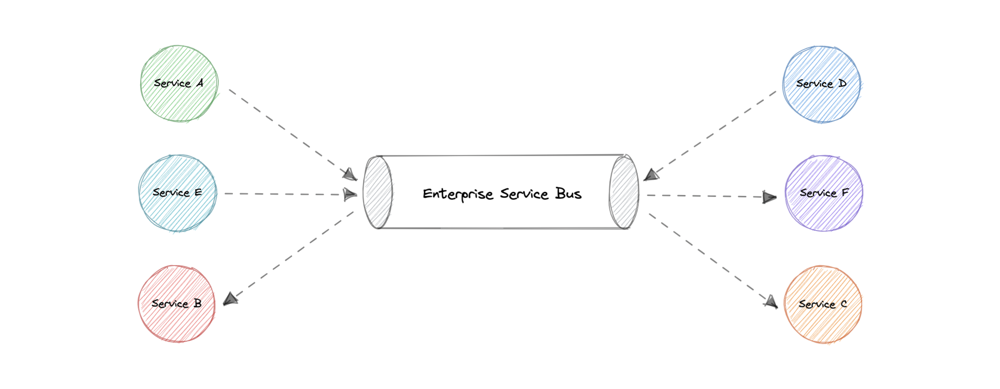

[← Category](README.md) · [Schedule](../../SCHEDULE.md)

<!-- BEGIN INQUIRY -->
## Try solving this first

Twelve legacy systems exchange incompatible formats. A central integration layer transforms and routes everything—until one change for payroll breaks inventory and no team understands the hidden rules. Which mediation belongs centrally, which business logic belongs with its owner, and how will you stop the shared hub becoming an organizational and runtime bottleneck?
<!-- END INQUIRY -->

<!-- BEGIN ORIGINAL TOPIC -->
# Enterprise Service Bus (ESB)

An Enterprise Service Bus (ESB) is an architectural pattern whereby a centralized software component performs integrations between applications. It performs transformations of data models, handles connectivity, performs message routing, converts communication protocols, and potentially manages the composition of multiple requests. The ESB can make these integrations and transformations available as a service interface for reuse by new applications.

## Advantages

In theory, a centralized ESB offers the potential to standardize and dramatically simplify communication, messaging, and integration between services across the enterprise. Here are some advantages of using an ESB:

- **Improved developer productivity**: Enables developers to incorporate new technologies into one part of an application without touching the rest of the application.
- **Simpler, more cost-effective scalability**: Components can be scaled independently of others.
- **Greater resilience**: Failure of one component does not impact the others, and each microservice can adhere to its own availability requirements without risking the availability of other components in the system.

## Disadvantages

While ESBs were deployed successfully in many organizations, in many other organizations the ESB came to be seen as a bottleneck. Here are some disadvantages of using an ESB:

- Making changes or enhancements to one integration could destabilize others who use that same integration.
- A single point of failure can bring down all communications.
- Updates to the ESB often impact existing integrations, so there is significant testing required to perform any update.
- ESB is centrally managed which makes cross-team collaboration challenging.
- High configuration and maintenance complexity.

## Examples

Below are some widely used Enterprise Service Bus (ESB) technologies:

- [Azure Service Bus](https://azure.microsoft.com/en-in/services/service-bus)
- [IBM App Connect](https://www.ibm.com/in-en/cloud/app-connect)
- [Apache Camel](https://camel.apache.org)
- [Fuse ESB](https://www.redhat.com/en/technologies/jboss-middleware/fuse)
<!-- END ORIGINAL TOPIC -->

## Make it concrete

An ESB transforms and routes messages between unlike systems. A broker mainly transports messages, although product features overlap.

Put billing-to-shipping transformations at explicit integration boundaries. Avoid accumulating changing business rules in one bus. Measure transformation cost and queue delay; bound retries so a failed shipping endpoint cannot monopolize processing. Redundant instances need working state and failover, not just extra machines.

Make the mapping explicit: a billing customer code and address might become the recipient identifier and delivery fields required by shipping. Validate missing or incompatible fields rather than silently producing a plausible but wrong shipment. Decide how an integration failure becomes visible to operators and to the originating order.

A failed endpoint can cause retries and queue growth. Give retries limits, backoff, and a recovery path for messages that cannot currently be delivered. Watch processing delay, not merely whether the bus process is alive.

Use the bus for required integration rather than centralizing every business decision there. Shared transformation infrastructure can reduce duplicated adapters while becoming a critical dependency for many flows at once.

[Next topic in this category](README.md) · [Credits and license](../../ATTRIBUTION.md)
