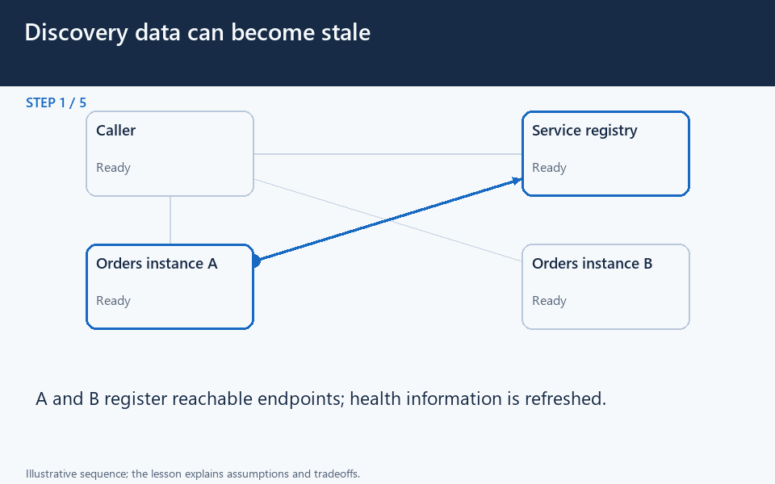

[← Category](README.md) · [Schedule](../../SCHEDULE.md)

<!-- BEGIN INQUIRY -->
## Try solving this first

An orders instance is replaced, but a long-lived caller keeps using its old address. How should the caller learn the change? Can a recently discovered destination still fail?
<!-- END INQUIRY -->

<!-- BEGIN ORIGINAL TOPIC -->
# Service Discovery

Service discovery is the detection of services within a computer network. Service Discovery Protocol (SDP) is a networking standard that accomplishes the detection of networks by identifying resources.

## Why do we need Service Discovery?

In a monolithic application, services invoke one another through language-level methods or procedure calls. However, modern microservices-based applications typically run in virtualized or containerized environments where the number of instances of a service and their locations change dynamically. Consequently, we need a mechanism that enables the clients of service to make requests to a dynamically changing set of ephemeral service instances.

## Implementations

There are two main service discovery patterns:

### Client-side discovery

In this approach, the client obtains the location of another service by querying a service registry which is responsible for managing and storing the network locations of all the services.

### Server-side discovery

In this approach, we use an intermediate component such as a load balancer. The client makes a request to the service via a load balancer which then forwards the request to an available service instance.

## Service Registry

A service registry is basically a database containing the network locations of service instances to which the clients can reach out. A Service Registry must be highly available and up-to-date.

## Service Registration

We also need a way to obtain service information, often known as service registration. Let's look at two possible service registration approaches:

### Self-Registration

When using the self-registration model, a service instance is responsible for registering and de-registering itself in the Service Registry. In addition, if necessary, a service instance sends heartbeat requests to keep its registration alive.

### Third-party Registration

The registry keeps track of changes to running instances by polling the deployment environment or subscribing to events. When it detects a newly available service instance, it records it in its database. The Service Registry also de-registers terminated service instances.

## Service mesh

Service-to-service communication is essential in a distributed application but routing this communication, both within and across application clusters, becomes increasingly complex as the number of services grows. Service mesh enables managed, observable, and secure communication between individual services. It works with a service discovery protocol to detect services. [Istio](https://istio.io/latest/about/service-mesh) and [envoy](https://www.envoyproxy.io) are some of the most commonly used service mesh technologies.

## Examples

Here are some commonly used service discovery infrastructure tools:

- [etcd](https://etcd.io)
- [Consul](https://www.consul.io)
- [Apache Thrift](https://thrift.apache.org)
- [Apache Zookeeper](https://zookeeper.apache.org)
<!-- END ORIGINAL TOPIC -->

<!-- BEGIN ANIMATION -->
## Watch the sequence

[Read the numbered steps](../../animations/discovery-heartbeat.md) · [View the still sequence](../../assets/animations/discovery-heartbeat-steps.png)
<!-- END ANIMATION -->

## Make it concrete

Discovery supplies service destinations; load balancing chooses among them. A discovered address can become stale before use.

For orders deployments, register instances using meaningful readiness checks. Stop new traffic and drain bounded in-flight work before retirement. Refresh cached discovery state and give calls deadlines and safe retry behavior. Caching reduces lookup traffic but delays learning about changes; repeatedly selecting the same failed address defeats failover.

Imagine an old instance completes a long-running request while a replacement starts. Removing the old address from new routing and terminating all existing work are separate actions. Use a bounded drain appropriate to the service, and define what happens when that bound is exceeded.

A registry or DNS answer can be correct when returned and obsolete a moment later. Clients must still handle connection failures and avoid blindly replaying non-idempotent writes. Repeatedly querying discovery on every request can add latency and another dependency; caching forever avoids lookups but preserves dead addresses. Test rollout, crash, and registry unavailability rather than only the normal lookup path.

[Next topic in this category](README.md) · [Credits and license](../../ATTRIBUTION.md)
