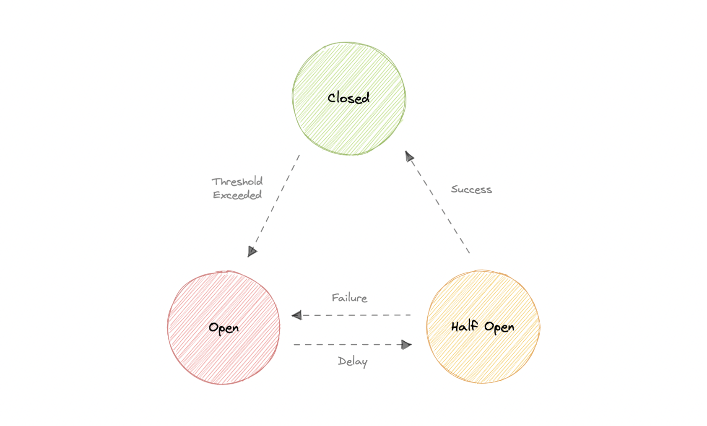
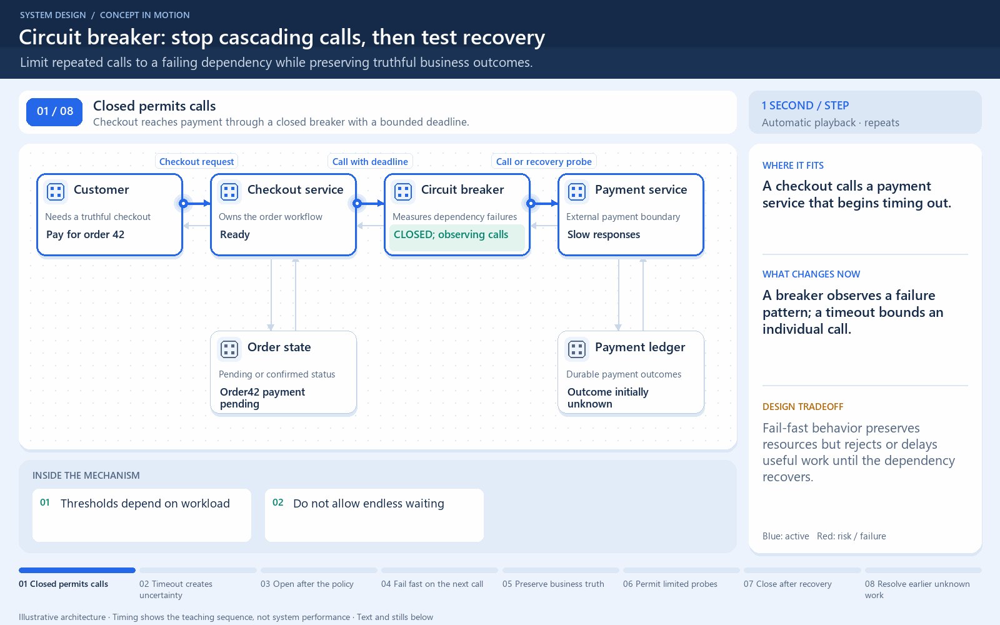

[← Category](README.md) · [Schedule](../../SCHEDULE.md)

<!-- BEGIN INQUIRY -->
## Try solving this first

A recommendation service slows from 50 ms to 20 seconds. Every checkout thread waits, retry traffic triples, and the healthy order path collapses behind an optional feature. When should calls stop reaching the dependency, what may the user see instead, and how will limited probes decide that recovery is real?
<!-- END INQUIRY -->

<!-- BEGIN ORIGINAL TOPIC -->
# Circuit breaker

The circuit breaker is a design pattern used to detect failures and encapsulates the logic of preventing a failure from constantly recurring during maintenance, temporary external system failure, or unexpected system difficulties.

The basic idea behind the circuit breaker is very simple. We wrap a protected function call in a circuit breaker object, which monitors for failures. Once the failures reach a certain threshold, the circuit breaker trips, and all further calls to the circuit breaker return with an error, without the protected call being made at all. Usually, we'll also want some kind of monitor alert if the circuit breaker trips.

## Why do we need circuit breaking?

It's common for software systems to make remote calls to software running in different processes, probably on different machines across a network. One of the big differences between in-memory calls and remote calls is that remote calls can fail, or hang without a response until some timeout limit is reached. What's worse is if we have many callers on an unresponsive supplier, then we can run out of critical resources leading to cascading failures across multiple systems.

## States

Let's discuss circuit breaker states:

### Closed

When everything is normal, the circuit breakers remain closed, and all the requests pass through to the services as normal. If the number of failures increases beyond the threshold, the circuit breaker trips and goes into an open state.

### Open

In this state circuit breaker returns an error immediately without even invoking the services. The Circuit breakers move into the half-open state after a certain timeout period elapses. Usually, it will have a monitoring system where the timeout will be specified.

### Half-open

In this state, the circuit breaker allows a limited number of requests from the service to pass through and invoke the operation. If the requests are successful, then the circuit breaker will go to the closed state. However, if the requests continue to fail, then it goes back to the open state.
<!-- END ORIGINAL TOPIC -->

<!-- BEGIN ANIMATION -->
## Watch the sequence

[Read the numbered steps](../../animations/circuit-breaker.md) · [View the still sequence](../../assets/animations/circuit-breaker-steps.png)
<!-- END ANIMATION -->

## Make it concrete

A breaker reacts to repeated dependency failures; a timeout bounds one call. Closed permits calls, open rejects them, and half-open admits limited recovery probes.

For payments, show pending or unavailable rather than inventing success. Separate unrelated dependencies and choose thresholds from traffic. Bound retries and use backoff so probes do not create another flood.

A stuck payment call can hold a worker, connection, or other resource that unrelated checkouts also need. Failing fast while the dependency is unhealthy protects that shared capacity. It does not cancel every request already in progress or repair the payment provider.

After a waiting period, allow a limited probe set rather than immediately releasing the entire backlog. Successful probes can support closing; failed probes reopen the breaker according to its policy. A low-traffic service may need different failure evaluation from one receiving thousands of calls each second.

Measure avoided failed calls, useful checkout success, and recovery delay. Keep payment state honest when a response is uncertain: a timeout does not prove that a charge never occurred.

[Next topic in this category](README.md) · [Credits and license](../../ATTRIBUTION.md)
