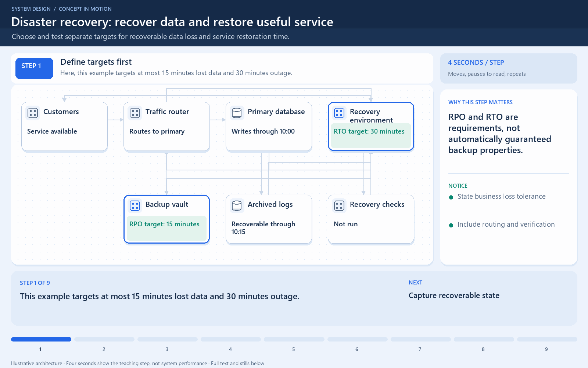

[← Category](README.md) · [Schedule](../../SCHEDULE.md)

<!-- BEGIN INQUIRY -->
## Try solving this first

A region fails when the latest usable order backup is an hour old. What can be lost? When will customers actually be able to purchase again?
<!-- END INQUIRY -->

<!-- BEGIN ORIGINAL TOPIC -->
# Disaster recovery

Disaster recovery (DR) is a process of regaining access and functionality of the infrastructure after events like a natural disaster, cyber attack, or even business disruptions.

Disaster recovery relies upon the replication of data and computer processing in an off-premises location not affected by the disaster. When servers go down because of a disaster, a business needs to recover lost data from a second location where the data is backed up. Ideally, an organization can transfer its computer processing to that remote location as well in order to continue operations.

_Disaster Recovery is often not actively discussed during system design interviews but it's important to have some basic understanding of this topic. You can learn more about disaster recovery from [AWS Well-Architected Framework](https://docs.aws.amazon.com/wellarchitected/latest/reliability-pillar/plan-for-disaster-recovery-dr.html)._

## Why is disaster recovery important?

Disaster recovery can have the following benefits:

- Minimize interruption and downtime
- Limit damages
- Fast restoration
- Better customer retention

## Terms

Let's discuss some important terms relevantly for disaster recovery:

### RTO

Recovery Time Objective (RTO) is the maximum acceptable delay between the interruption of service and restoration of service. This determines what is considered an acceptable time window when service is unavailable.

### RPO

Recovery Point Objective (RPO) is the maximum acceptable amount of time since the last data recovery point. This determines what is considered an acceptable loss of data between the last recovery point and the interruption of service.

## Strategies

A variety of disaster recovery (DR) strategies can be part of a disaster recovery plan.

### Back-up

This is the simplest type of disaster recovery and involves storing data off-site or on a removable drive.

### Cold Site

In this type of disaster recovery, an organization sets up basic infrastructure in a second site.

### Hot site

A hot site maintains up-to-date copies of data at all times. Hot sites are time-consuming to set up and more expensive than cold sites, but they dramatically reduce downtime.
<!-- END ORIGINAL TOPIC -->

<!-- BEGIN ANIMATION -->
## Watch the sequence

[Read the numbered steps](../../animations/recovery-objectives.md) · [View the still sequence](../../assets/animations/recovery-objectives-steps.png)
<!-- END ANIMATION -->

## Make it concrete

RPO limits tolerable data loss; RTO limits recovery time. Hourly backups with no newer recoverable log imply roughly an hour of possible data loss.

Rehearse restoring order data, configuration, credentials, and traffic routing. Measure when customers can work again, not when file copying finishes. Faster restore improves RTO; more frequent recoverable capture improves RPO. Protect backups from production deletion and compromise.

Take an example failure at 10:50 with a recoverable backup from 10:00 and no later usable log. Orders committed after the backup may be unrecoverable through that backup alone. Restoring files in ten minutes does not establish a ten-minute recovery time if credentials, application settings, or traffic routing take another hour.

Practice recovery in an isolated environment and check application-level invariants, not just whether restored tables open. Include the people, access, and dependencies needed during the incident.

Replication is not a substitute for all backups: accidental deletion can be copied to replicas. Faster failover and independent recoverable history address different failure scenarios. Choose their cost from the required loss and downtime tolerance.

[Next topic in this category](README.md) · [Credits and license](../../ATTRIBUTION.md)
