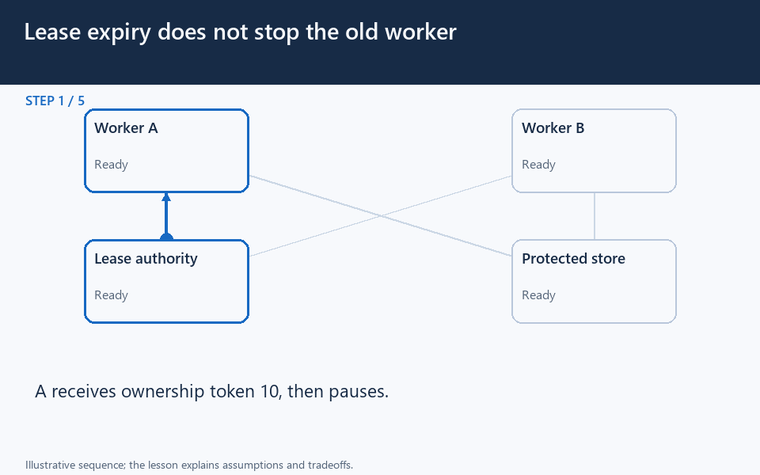

# Distributed Locking

[← Category](README.md) · [Schedule](../../SCHEDULE.md)

<!-- BEGIN INQUIRY -->
## Try solving this first

Worker A acquires a five-second lease, pauses for ten seconds, and resumes after worker B has acquired the same lock. Both believe they own the job and write to storage. A timeout-based lock did not stop the old process. What evidence lets the protected resource reject A’s late write?
<!-- END INQUIRY -->

## Coordinate work across processes carefully

A distributed lock tries to give one participant temporary ownership of work shared across machines. A local language mutex only coordinates within its own process or runtime.

Imagine two workers generating a monthly report. A shared lock can reduce simultaneous execution. But worker A may pause so long that its lease expires. Worker B acquires a new lease, then A resumes and continues writing. Both now believe they have work to do.

A **lease** is ownership valid until a deadline. A **fencing token** is a number that increases each time ownership is granted; the protected resource checks it. If B has a newer token, the resource can reject A's stale write. This works only if the resource actually enforces the check.

The design must specify ownership, expiry, renewal, safe release, and what happens during network partitions. A lock alone does not guarantee exactly-once execution. A uniqueness constraint, conditional write, or idempotent operation can sometimes express the invariant more directly.

**Check:** “the lease expired” does not mean the former holder has physically stopped running.

## Where this comes into play

Locks can coordinate work such as refreshing a cache entry or assigning a job across processes. First decide whether duplicate work is merely expensive or would violate correctness. That distinction changes how strong the coordination must be.

## Work through a stale owner

Worker A gets lease token 10 and pauses. Its lease expires. B receives token 11 and writes the new report. A resumes and tries an older write. If the protected store checks ownership tokens, it can reject token 10 after observing token 11. If it ignores tokens, issuing them alone provides no protection.

Keep release ownership-safe too. A worker must not delete a lock that has expired and been acquired by someone else merely because the lock key has the same name.

## How to optimize or simplify it

Reduce the protected critical section: the period when exclusive ownership is required. Avoid slow external calls while holding a lease when the invariant permits another arrangement. Split ownership by a meaningful resource identifier if different resources can safely proceed independently.

Choose expiry and renewal behavior for expected pauses and failures. A longer lease delays takeover; a shorter one increases expiry during legitimate work. There is no universally correct duration.

Consider expressing correctness directly with a unique constraint, versioned conditional update, or idempotent operation. A lock that only reduces duplicate cache reloads may be best-effort; a lock protecting irreversible financial effects needs a much stronger end-to-end argument.

## How to verify improvement

Pause an owner past expiry, disconnect it, race acquisitions, and resume old work after takeover. Measure contention and time waiting, and confirm stale owners cannot violate the protected invariant.

<!-- BEGIN ANIMATION -->
## Watch the sequence

[Read the numbered steps](../../animations/fencing-token.md) · [View the still sequence](../../assets/animations/fencing-token-steps.png)
<!-- END ANIMATION -->

## Optional further reading

- [Distributed locks and fencing](https://martin.kleppmann.com/2016/02/08/how-to-do-distributed-locking.html)

Optional references provide more detail; they are not required to follow this lesson.
