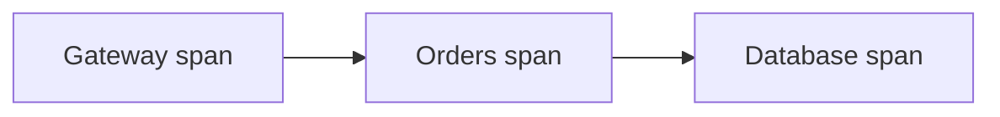
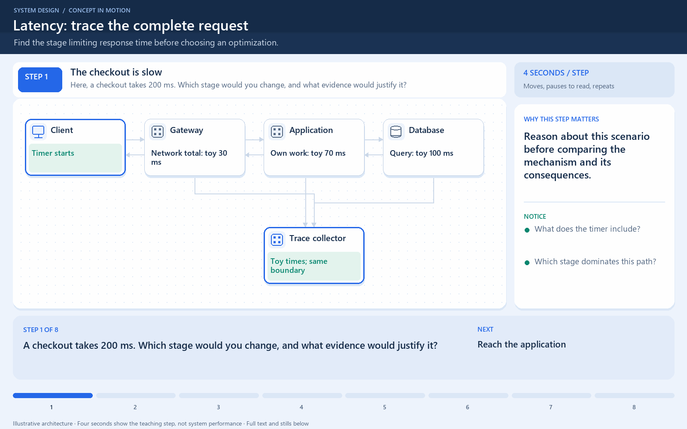

# Distributed Tracing

[← Category](README.md) · [Schedule](../../SCHEDULE.md)

## Follow one request across several services

A trace connects the work caused by one request. Each measured operation is a **span**, with timing and relationships to other spans. Shared context lets different services connect their spans to the same trace.

Example: opening an order page calls a gateway, an orders service, and a database. A trace can show that most of the request's delay happened in the database call, rather than merely showing that the whole page was slow.

Trace context must travel with the request or message. An asynchronous worker may start later and still need a causal link to the event that triggered it. Sampling can reduce collection cost, so not every request is necessarily recorded.

Metrics summarize patterns across requests; logs record events; traces connect work along a request's path. They complement each other. Avoid recording secrets or unnecessary personal data in span attributes.

**Check:** a trace helps locate a slow step. It does not automatically explain the underlying cause or fix the bottleneck.

## Where this comes into play

Tracing is especially useful when a user request crosses services, databases, caches, and asynchronous workers. A single “page took two seconds” metric does not identify which dependency or waiting stage consumed that time.

## Work through a slow order page

Suppose the gateway adds 20 ms of its own work, the orders service adds 30 ms of its own work, and a sequential database call takes 950 ms. These are separate contributions, not inclusive parent-span times. A trace points the investigation toward that database operation. Inspect the query and its execution behavior before adding application instances.

Some spans overlap. If the orders service calls inventory and delivery concurrently, adding both durations double-counts overlapping time. Follow the critical path, the chain that determines completion, rather than summing every span in the trace.

## How to make tracing useful and affordable

Propagate trace context through both HTTP calls and message metadata. Record meaningful operation names and bounded attributes, such as an error category. Avoid secrets and unnecessary personal data. Very large or unbounded attribute values increase cost and can make analysis harder.

Sampling means keeping a subset of traces. A small uniform sample reduces volume but may miss rare failures. Where supported, other sampling approaches can prioritize errors or slow traces, at extra collection and processing cost. Sampling is an observability tradeoff, not a guarantee that every problematic request is retained.

## How to verify improvement

Trace a deliberately slow test request across every expected boundary. Check for missing spans and broken parent relationships. Measure instrumentation overhead and confirm you can connect a slow request to relevant metrics and logs before relying on the system during an incident.

<!-- BEGIN ANIMATION -->
## Watch the sequence

Open the looping animation

[Read the numbered steps](../../animations/request-latency.md) · [View the still sequence](../../assets/animations/request-latency-steps.png)
<!-- END ANIMATION -->

## Optional further reading

- [Additional explanation](https://www.dynatrace.com/news/blog/what-is-distributed-tracing/)
- [OpenTelemetry: traces](https://opentelemetry.io/docs/concepts/signals/traces/)

Optional references provide more detail; they are not required to follow this lesson.
