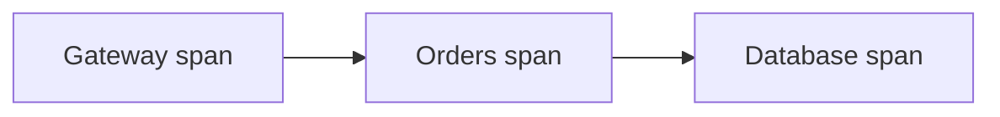

# Distributed Tracing

[← Category](README.md) · [Schedule](../../SCHEDULE.md)

## Follow one request across several services

A trace connects the work caused by one request. Each measured operation is a **span**, with timing and relationships to other spans. Shared context lets different services connect their spans to the same trace.

Example: opening an order page calls a gateway, an orders service, and a database. A trace can show that most of the request's delay happened in the database call, rather than merely showing that the whole page was slow.

Trace context must travel with the request or message. An asynchronous worker may start later and still need a causal link to the event that triggered it. Sampling can reduce collection cost, so not every request is necessarily recorded.

Metrics summarize patterns across requests; logs record events; traces connect work along a request's path. They complement each other. Avoid recording secrets or unnecessary personal data in span attributes.

**Check:** a trace helps locate a slow step. It does not automatically explain the underlying cause or fix the bottleneck.

## Optional further reading

- [Additional explanation](https://www.dynatrace.com/news/blog/what-is-distributed-tracing/)
- [OpenTelemetry: traces](https://opentelemetry.io/docs/concepts/signals/traces/)

The lesson above is complete enough for this curriculum; external links are for deeper study.
