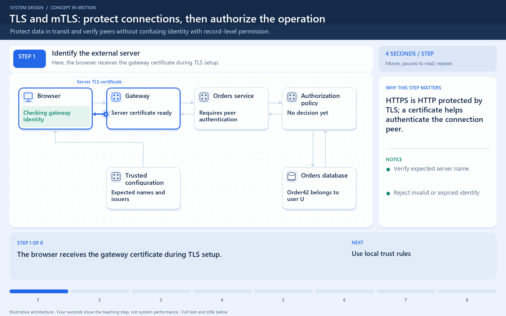

[← Category](README.md) · [Schedule](../../SCHEDULE.md)

<!-- BEGIN INQUIRY -->
## Try solving this first

A service presents a valid certificate for the wrong hostname, while another authenticated service attempts an operation it is not allowed to perform. The connections are encrypted, yet one peer may be an impostor and the other lacks permission. What identity should each side verify, where is authorization enforced, and when is mutual authentication worth the operational cost?
<!-- END INQUIRY -->

<!-- BEGIN ORIGINAL TOPIC -->
# SSL, TLS, mTLS

Let's briefly discuss some important communication security protocols such as SSL, TLS, and mTLS. I would say that from a _"big picture"_ system design perspective, this topic is not very important but still good to know about.

## SSL

SSL stands for Secure Sockets Layer, and it refers to a protocol for encrypting and securing communications that take place on the internet. It was first developed in 1995 but since has been deprecated in favor of TLS (Transport Layer Security).

### Why is it called an SSL certificate if it is deprecated?

Most major certificate providers still refer to certificates as SSL certificates, which is why the naming convention persists.

### Why was SSL so important?

Originally, data on the web was transmitted in plaintext that anyone could read if they intercepted the message. SSL was created to correct this problem and protect user privacy. By encrypting any data that goes between the user and a web server, SSL also stops certain kinds of cyber attacks by preventing attackers from tampering with data in transit.

## TLS

Transport Layer Security, or TLS, is a widely adopted security protocol designed to facilitate privacy and data security for communications over the internet. TLS evolved from a previous encryption protocol called Secure Sockets Layer (SSL). A primary use case of TLS is encrypting the communication between web applications and servers.

There are three main components to what the TLS protocol accomplishes:

- **Encryption**: hides the data being transferred from third parties.
- **Authentication**: ensures that the parties exchanging information are who they claim to be.
- **Integrity**: verifies that the data has not been forged or tampered with.

## mTLS

Mutual TLS, or mTLS, is a method for mutual authentication. mTLS ensures that the parties at each end of a network connection are who they claim to be by verifying that they both have the correct private key. The information within their respective TLS certificates provides additional verification.

### Why use mTLS?

mTLS helps ensure that the traffic is secure and trusted in both directions between a client and server. This provides an additional layer of security for users who log in to an organization's network or applications. It also verifies connections with client devices that do not follow a login process, such as Internet of Things (IoT) devices.

Nowadays, mTLS is commonly used by microservices or distributed systems in a [zero trust security model](https://en.wikipedia.org/wiki/Zero_trust_security_model) to verify each other.
<!-- END ORIGINAL TOPIC -->

<!-- BEGIN ANIMATION -->
## Watch the sequence

[Read the numbered steps](../../animations/tls-mtls.md) · [View the still sequence](../../assets/animations/tls-mtls-steps.png)
<!-- END ANIMATION -->

## Make it concrete

TLS protects a connection; usually the client verifies the server certificate. mTLS also verifies a client certificate. SSL is obsolete.

At a gateway, design protection for the new internal connection separately. An identified calling service still needs authorization for the operation. Automate certificate renewal and monitor expiry. Reuse suitable connections to reduce handshakes, but never skip certificate verification for speed.

Trace the data hop by hop. Browser-to-gateway TLS protects that connection. If the gateway reads the request and opens another connection, the internal hop needs its own protection decision and endpoint checks. The browser's verified server identity does not automatically become the identity of every internal caller.

With mTLS, possession of a trusted client certificate can establish a calling identity; the receiving service still decides whether that identity may read or change a particular order. Plan certificate expiry, rotation, and trust changes as operational work.

Measure connection setup and reuse before optimizing. Disabling verification removes an identity check rather than improving the same security guarantee faster.

[Next topic in this category](README.md) · [Credits and license](../../ATTRIBUTION.md)
