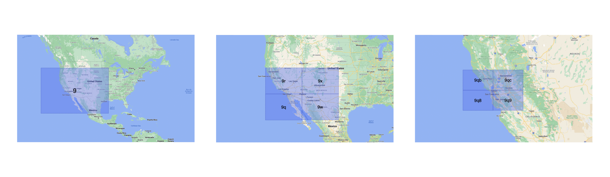
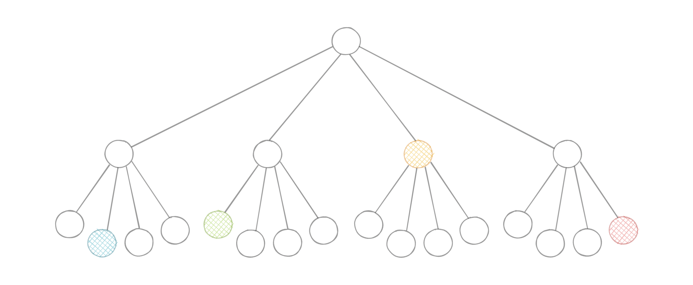
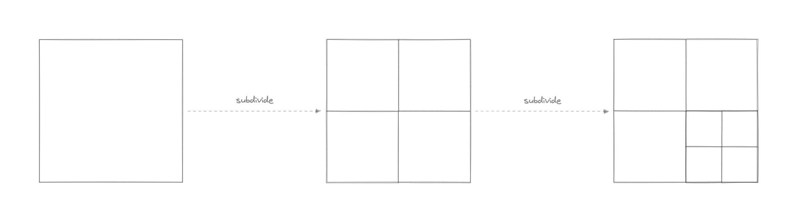
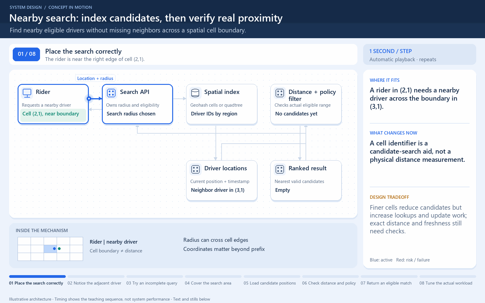

[← Category](README.md) · [Schedule](../../SCHEDULE.md)

<!-- BEGIN INQUIRY -->
## Try solving this first

A rider stands one metre from a driver—but on the opposite side of a map-cell boundary. Another driver appears nearby because their location is two minutes old. Searching only the rider’s cell misses the best candidate. Which neighbouring space must be searched, how should distance be verified, and why is finding a driver different from reserving one?
<!-- END INQUIRY -->

<!-- BEGIN ORIGINAL TOPIC -->
# Geohashing and Quadtrees

## Geohashing

Geohashing is a [geocoding](https://en.wikipedia.org/wiki/Address_geocoding) method used to encode geographic coordinates such as latitude and longitude into short alphanumeric strings. It was created by [Gustavo Niemeyer](https://twitter.com/gniemeyer) in 2008.

For example, San Francisco with coordinates `37.7564, -122.4016` can be represented in geohash as `9q8yy9mf`.

### How does Geohashing work?

Geohash is a hierarchical spatial index that uses Base-32 alphabet encoding, the first character in a geohash identifies the initial location as one of the 32 cells. This cell will also contain 32 cells. This means that to represent a point, the world is recursively divided into smaller and smaller cells with each additional bit until the desired precision is attained. The precision factor also determines the size of the cell.

Geohashing guarantees that points are spatially closer if their Geohashes share a longer prefix which means the more characters in the string, the more precise the location. For example, geohashes `9q8yy9mf` and `9q8yy9vx` are spatially closer as they share the prefix `9q8yy9`.

Geohashing can also be used to provide a degree of anonymity as we don't need to expose the exact location of the user because depending on the length of the geohash we just know they are somewhere within an area.

The cell sizes of the geohashes of different lengths are as follows:

| Geohash length | Cell width | Cell height |
| -------------- | ---------- | ----------- |
| 1              | 5000 km    | 5000 km     |
| 2              | 1250 km    | 1250 km     |
| 3              | 156 km     | 156 km      |
| 4              | 39.1 km    | 19.5 km     |
| 5              | 4.89 km    | 4.89 km     |
| 6              | 1.22 km    | 0.61 km     |
| 7              | 153 m      | 153 m       |
| 8              | 38.2 m     | 19.1 m      |
| 9              | 4.77 m     | 4.77 m      |
| 10             | 1.19 m     | 0.596 m     |
| 11             | 149 mm     | 149 mm      |
| 12             | 37.2 mm    | 18.6 mm     |

### Use cases

Here are some common use cases for Geohashing:

- It is a simple way to represent and store a location in a database.
- It can also be shared on social media as URLs since it is easier to share, and remember than latitudes and longitudes.
- We can efficiently find the nearest neighbors of a point through very simple string comparisons and efficient searching of indexes.

### Examples

Geohashing is widely used and it is supported by popular databases.

- [MySQL](https://www.mysql.com)
- [Redis](https://redis.io)
- [Amazon DynamoDB](https://aws.amazon.com/dynamodb)
- [Google Cloud Firestore](https://cloud.google.com/firestore)

## Quadtrees

A quadtree is a tree data structure in which each internal node has exactly four children. They are often used to partition a two-dimensional space by recursively subdividing it into four quadrants or regions. Each child or leaf node stores spatial information. Quadtrees are the two-dimensional analog of [Octrees](https://en.wikipedia.org/wiki/Octree) which are used to partition three-dimensional space.

### Types of Quadtrees

Quadtrees may be classified according to the type of data they represent, including areas, points, lines, and curves. The following are common types of quadtrees:

- Point quadtrees
- Point-region (PR) quadtrees
- Polygonal map (PM) quadtrees
- Compressed quadtrees
- Edge quadtrees

### Why do we need Quadtrees?

Aren't latitudes and longitudes enough? Why do we need quadtrees? While in theory using latitude and longitude we can determine things such as how close points are to each other using [euclidean distance](https://en.wikipedia.org/wiki/Euclidean_distance), for practical use cases it is simply not scalable because of its CPU-intensive nature with large data sets.

Quadtrees enable us to search points within a two-dimensional range efficiently, where those points are defined as latitude/longitude coordinates or as cartesian (x, y) coordinates. Additionally, we can save further computation by only subdividing a node after a certain threshold. And with the application of mapping algorithms such as the [Hilbert curve](https://en.wikipedia.org/wiki/Hilbert_curve), we can easily improve range query performance.

### Use cases

Below are some common uses of quadtrees:

- Image representation, processing, and compression.
- Spacial indexing and range queries.
- Location-based services like Google Maps, Uber, etc.
- Mesh generation and computer graphics.
- Sparse data storage.
<!-- END ORIGINAL TOPIC -->

<!-- BEGIN ANIMATION -->
## Watch the sequence

[Read the numbered steps](../../animations/nearby-search.md) · [View the still sequence](../../assets/animations/nearby-search-steps.png)
<!-- END ANIMATION -->

## Make it concrete

Geohashes encode locations into grid cells; quadtrees repeatedly subdivide regions. They narrow candidates before exact distance checks rather than proving which driver is closest.

For ride matching, inspect relevant and neighboring cells, then calculate actual distances and check eligibility and freshness. Two nearby points can lie across a boundary. Choose precision against search radius and density: coarse cells return excess candidates; overly fine cells need more lookups. Expand outward when too few eligible candidates remain.

For quadtrees, split busy regions with sensible depth or occupancy limits. Moving drivers require index updates, so measure maintenance as well as lookup speed. Reject stale records or handle them under an explicit tolerance. A fast search over outdated positions can still produce a wrong result.

The spatial search returns candidates, not a reservation. In a ride design, check current driver availability and claim an assignment through authoritative state after discovery. Increasing geographical precision cannot solve a race where two riders select the same available driver. Measure search quality, location age, and assignment success separately.

[Next topic in this category](README.md) · [Credits and license](../../ATTRIBUTION.md)
